# 20 · 两阶段路线图与里程碑（Phase 1 W1–W8 · Phase 2 W9–W20）

> 负责人：队友 F（roadmap-synth）｜共享任务：task-4（依赖 task-1/2/3/5/7，均已完成）｜状态：**DRAFT v1**（2026-10-05，Asia/Shanghai）
> 起算日：**2026-10-05（周一）= W1 第 1 天**；本文所有日期为「截止日（含当日）」，每周区间见 §1。
> 事实纪律：本文**不新增任何未测数据**。每个数字标注来源类型：【实测】= 引用已交付文档中的本机实测值；【估算】= 人日估算并附依据；【假设】= 需验证项，验证动作见 §9。
> 真相源（只引用、不重新论证）：契约 [00-interface-contract.md](./00-interface-contract.md) v1.2（§5.2.1 / §5.4 / §7 / §8 / §9）；技术栈 [30-implementation-stack.md](./30-implementation-stack.md)（§3.2 / §5.1 / §6 / §7.2 / §9）；DSH 桥接 [35-dsh-pet-bridge.md](./35-dsh-pet-bridge.md)（§3.5 / §4 / §8）；适配矩阵 [40-adapters.md](./40-adapters.md)（§0 / §4 / §6）；产品规格 [50-product-spec.md](./50-product-spec.md)（§3.2 / §5.3 / §6 / §11）；工作框规格 [51-work-frame-spec.md](./51-work-frame-spec.md)（**DRAFT v0.1，2026-10-05**——本文引用其三种形态「窄条 320×40 / 卡片 260×160 / 宠物形态 96×96 + 36 px 迷你条」与 WF-01 ~ WF-22 验收清单）；团队与 Gate [70-team-and-metrics.md](./70-team-and-metrics.md)（§1 / §2 / §3）；风险登记册 [60-risk-register.md](./60-risk-register.md)（R-01 ~ R-21）。

## 0. 一页速览

| 项 | 结论 |
|---|---|
| 时间盒 | Phase 1 = **W1–W8（2026-10-05 ~ 2026-11-29，8 周）**；Phase 2 = **W9–W20（2026-11-30 ~ 2027-02-21，12 周）** |
| 主界面 | **工作框（Work Frame）**，主职责是「表示状态」：先窄条 320×40，再卡片 260×160；宠物形态是框内的可选元素 |
| 三个不可协商的锚点 | ① **M2 截止 W5（2026-11-08）**：真实 DSH 会话驱动工作框状态变化，**只走日志 tail 兜底、不需要用户改任何配置**；② **适配器 SDK v1.0 冻结 W14（2027-01-10）**，冻结前提是 3 个 P0 适配器实测通过契约一致性测试；③ **Gate1 = W8（2026-11-29）/ Gate2 = W20（2027-02-21）** |
| 无阻塞路径 | 日志 tail（p50 247 ms【实测】，零授权）先跑通并成为 demo 主路径 → W5 末申请「一行 insert」挂 Cordis 插件（<1 ms【实测】）→ **拿不到授权也不改 Gate1 日期**（§2.2 / §9-A1） |
| 主选栈 | **Tauri v2**：.app 4.0 MB、空闲 phys_footprint 57.1 MB、启动 208–475 ms、socket→JSONL→6 态全链路已在本机跑通【实测】；备选纯 Swift+AppKit（13 MB，Windows 归零）、Electron 44.5.1（footprint 89.2 MB，但与 DSH 同栈） |
| 最大的三件事 | ① 真实 desktop profile 挂插件需**用户授权**（可绕过）；② **Windows 无机器未测**（Phase 2 分发的不确定性）；③ **Live2D/Spine 授权未核验**（MVP 已用分层帧动画绕开） |
| 团队基线 | 3 人核心（外壳 1 + Hub/适配器 1 + 设计 0.5~1）+ QA 0.5 弹性（[docs/70](./70-team-and-metrics.md) §1）；1/2/3 人排期差异见 §7.5 |

## 1. 排期基线：W1–W20 与实际日期

| 周 | 实际日期区间 | Sprint | 里程碑节点 | 检查点 / Gate |
|---|---|---|---|---|
| W1 | 2026-10-05 ~ 2026-10-11 | S1 | M0 契约与骨架冻结 | — |
| W2 | 2026-10-12 ~ 2026-10-18 | S1 | M1 兜底链路开工 | Sprint 评审（W2 周四） |
| W3 | 2026-10-19 ~ 2026-10-25 | S2 | M1 完成 | — |
| W4 | 2026-10-26 ~ 2026-11-01 | S2 | M2 工作框可见 | — |
| W5 | 2026-11-02 ~ 2026-11-08 | S3 | **M2 完成（★ 可演示锚点）** | 授权申请发出 / 首次端到端演示 |
| W6 | 2026-11-09 ~ 2026-11-15 | S3 | M3 主路径插件（若已授权） | — |
| W7 | 2026-11-16 ~ 2026-11-22 | S4 | M4 交付面 | — |
| W8 | 2026-11-23 ~ 2026-11-29 | S4 | M5 硬化完成 | **Gate1** |
| W9 | 2026-11-30 ~ 2026-12-06 | S5 | M6 SDK 抽取开工 | — |
| W10 | 2026-12-07 ~ 2026-12-13 | S5 | M6 完成（SDK v0.9） | — |
| W11 | 2026-12-14 ~ 2026-12-20 | S6 | M7 Claude Code 适配开工 | — |
| W12 | 2026-12-21 ~ 2026-12-27 | S6 | M7 完成 | — |
| W13 | 2026-12-28 ~ 2027-01-03 | S7 | M8 Codex + ACP 适配 | 跨年周（产能折减 30%【假设】） |
| W14 | 2027-01-04 ~ 2027-01-10 | S7 | M8 完成 | **适配器 SDK v1.0 冻结** |
| W15 | 2027-01-11 ~ 2027-01-17 | S8 | M9 皮肤市场 + 渲染器插件化 | — |
| W16 | 2027-01-18 ~ 2027-01-24 | S8 | M9 分发（签名/公证/自动更新） | — |
| W17 | 2027-01-25 ~ 2027-01-31 | S9 | M9 完成 | Windows 验证截止（无机器则砍，§6/§9-A2） |
| W18 | 2027-02-01 ~ 2027-02-07 | S9 | M10 商业化与企业最小版 | 春节周（2027-02-06，产能折减 50%【假设】） |
| W19 | 2027-02-08 ~ 2027-02-14 | S10 | M10 收口 | — |
| W20 | 2027-02-15 ~ 2027-02-21 | S10 | M10 完成 | **Gate2** |

- **节奏**：两周一 Sprint（S1–S10），与 [docs/70](./70-team-and-metrics.md) §2 一致（周一计划 / 周三可选 Demo / 第二周周四评审 / 第二周周五复盘 + 缓冲）。
- **日期口径**：里程碑日期 = 所在周的周日（含）。W1 起始日 2026-10-05 经核对为**周一**。
- **校历假设【假设】**：2027-02-06（周六，落在 W18）为春节，放假安排以国务院办公厅通知为准（**未核验**）；缓解动作见 §9-A6。2026-12-28 ~ 2027-01-03 跨年周按产能 70% 计。
- **缓冲**：每个 Sprint 的周五留 1 天为缓冲；阶段末不额外留「整周缓冲」——风险应对靠 §6 的砍需求顺序，而不是靠乐观估计。

## 2. Phase 1（W1–W8）：DSH 工作框 demo

### 2.0 阶段目标与非目标

- **目标**：在 macOS 交付一个**常驻的 DSH 工作框**——用真实 DSH 会话事件驱动状态与进度显示（含审批/提问强提醒，**只读**），有安装包、有崩溃隔离、有可验证的隐私边界。
- **非目标（Phase 1 明确不做）**：多后端（Claude Code/Codex/ACP…）、在桌宠上允许/拒绝（契约 §5.4 Phase 1 只读）、Live2D/VRM、Windows 分发、团队看板与审计、LLM 生成文案（R-11）。

### 2.1 Phase 1 里程碑骨架

| 里程碑 | 周次 | 截止日 | 一句话交付 | 验收详见 |
|---|---|---|---|---|
| M0 | W1 | 2026-10-11 | 契约/schema/fixture/仓库骨架/ADR 冻结为回归基线 | §2.3-M0 |
| M1 | W2–W3 | 2026-10-25 | 日志 tail → Hub 权威状态机 → 快照，全链路无授权跑通 | §2.3-M1 |
| **M2** | **W4–W5** | **2026-11-08** | **真实 DSH 会话驱动窄条工作框状态变化（★）** | §2.3-M2 |
| M3 | W6 | 2026-11-15 | Cordis 插件主路径（需用户授权）+ 双路径对账 | §2.3-M3 |
| M4 | W7 | 2026-11-22 | 交付面：安装包/引导/卡片形态/皮肤包 v1/托盘与设置 | §2.3-M4 |
| M5 | W8 | 2026-11-29 | 硬化、证据与 Gate1（含 5 分钟演示） | §2.3-M5 |

### 2.2 关键设计：先兜底、再授权（无阻塞路径）★

| | 轨道 A（兜底，**零授权**） | 轨道 B（主路径，**需一次用户授权**） |
|---|---|---|
| 机制 | 会话日志多帧 zstd 增量 tail（`adapters/_reference/dsh-log-tail.mjs`，已交付可跑） | Cordis 本地插件进程内订阅 `session/event` |
| 延迟 | p50 **247 ms**（72% ≤300 ms）【实测】 | **<1 ms**（进程内同步派发）【实测】 |
| 覆盖 | DSH 16 类中 12 类可达（9 类 1:1）【实测】；`session.end` 需启发式 | 同映射器 + `session/disposed` 更可靠 |
| 落地周 | W3（M1 内） | W6（M3，授权后）；授权申请 W5 末发出 |
| 阻塞风险 | 无 | 用户不同意改 `cordis.patch.yml` → M3 顺延，**不影响 Gate1** |

**执行规则（写死，防止路线图变成「等授权」）**：
1. **Gate1 的全部指标必须在「只开轨道 A」时成立**（延迟指标按 §2.3-M5 的双口径分别报告：轨道 A P95 ≤600 ms、轨道 B P95 ≤200 ms）。
2. 向用户提授权时，交付物必须是一个「一键可回滚的最小改动包」：`cordis.patch.yml` **追加**一条 `insert`（只增不删，不触碰现有行）+ diff + 回滚脚本（回滚后 `shasum` 与备份一致）+ 复现步骤（机制已在 /tmp 自建 profile 上实测，真实 desktop profile 属未验证项，见 §9-A1）。
3. 两条轨道**同时跑并自动对账**：同一会话的规范事件序列差异必须为 0；轨道 A 同时充当取证与回归数据源（日志 tail 是可离线重放的）。
4. 若 W6 结束时仍未获授权：M3 延期至 W9+（Phase 2 的 S5 窗口），路线图其余部分不变，Gate1 演示用轨道 A 完成，并在演示中**明说**当前延迟口径。

### 2.3 Phase 1 里程碑卡片（M0–M5）

> 每张卡片给出：目标 / 交付物 / 验收（可执行或可观测）/ 负责人角色 / 依赖 / 风险 / 人日【估算】。
> 「负责人角色」沿用 [docs/70](./70-team-and-metrics.md) §1 的角色名；工作框界面的界面级验收沿用 [docs/51](./51-work-frame-spec.md) §7 的 WF-01 ~ WF-22。

#### M0 · 契约与骨架冻结（W1，截止 2026-10-11）

| 项 | 内容 |
|---|---|
| 目标 | 把「接口真相源 + 校验器 + 回放基线 + 仓库骨架」冻结成回归基线，后续所有工作以此为门禁 |
| 交付物 | 契约 v1.2（FROZEN，已交付）；`schema/pet-event.schema.json` + `schema/validate-pet-event.mjs`（已交付）；`fixtures/contract-sample.pet.jsonl`（16 行 / 16 个 type 字符串 + 3 条未知 type + 3 个控制帧，已交付）；`scripts/check-fixtures.mjs`、`scripts/replay-check.mjs`（已交付）；仓库骨架（[docs/30](./30-implementation-stack.md) §6：`apps/desktop`、`packages/{contract,adapter-sdk,pet-assets}`、`adapters/`、`fixtures/`）；ADR-1 ~ ADR-7 在 README 建索引（[docs/10](./10-architecture.md) §2） |
| 验收（可执行） | ① `node schema/validate-pet-event.mjs --self-test` 退出码 0；② `node scripts/check-fixtures.mjs` 输出「type 覆盖: 规范 16/16」且「全部检查通过」；③ `node scripts/replay-check.mjs fixtures/contract-sample.pet.jsonl` 复现 6 个状态与 5 类特效；④ 骨架 `pnpm -r build` 空跑通过；⑤ CI 挂上前三条（契约一致性问题回归即红） |
| 负责人角色 | Lead（契约/schema 已由 task-3/task-7 交付）→ 移交 **Hub 工程师** 长期维护 |
| 依赖 | task-1 / task-3 / task-7 产出（均已完成） |
| 风险 | R-12（契约沦为文档）→ 一致性测试进 CI；契约 §9 的变更流程（PR + 兼容性影响 + 回归）即本里程碑的运营方式 |
| 人日【估算】 | **2**（剩余量：骨架 + CI，契约与校验器已在 W0 前置完成） |

#### M1 · 兜底链路 + Hub 权威状态机（W2–W3，截止 2026-10-25）

| 项 | 内容 |
|---|---|
| 目标 | 「DSH 会话日志 → 规范事件 → Hub 状态机 → 快照」端到端跑通，**全程零授权、零改配置**；把状态真相钉在 Hub（ADR-2） |
| 交付物 | ① Hub：unix socket `$TMPDIR/agent-pet/dsh.sock` 监听 + `ctl:hello`/`ctl:ack` 握手（3 s 超时、重试 2 次、`canDecide:false`）+ 契约 §4 状态机（优先级、未决登记、2 s/32 条乱序窗、`(source,sessionId,seq)` 去重、45 s 离线、10 min `stale`）+ 录制器（`~/.agent-pet/records/<source>-<date>.pet.jsonl`，0600，20 MB × 7 天）；② 兜底适配器接入：`node adapters/_reference/dsh-log-tail.mjs --latest --follow --socket $TMPDIR/agent-pet/dsh.sock`（多会话 fan-out）；③ `--replay` 回放模式（跳过握手，控制帧按契约 §2.2 忽略） |
| 验收（可执行/可观测） | ① 起 Hub 后跑适配器，Hub 打印 `ack ok=true canDecide=false`，随后收到真实会话事件；② `--replay fixtures/contract-sample.pet.jsonl` 的 6 态迁移序列可被脚本断言；③ 注入 1000 条未知 type → `unknownEvents=1000`、无异常、RSS 漂移 <5%（契约 §7 第 3 条）；④ `kill -9` 适配器 → 45 s 内 source 离线、聚合回落且无残留「忙碌」（契约 §7 第 2 条）；⑤ 乱序收敛（窗口内乱序 = 顺序结果；跨窗口迟到计 `lateEvents` 且状态不倒退，契约 §7 第 4 条）；⑥ 未握手就发事件 → 拒收并计数、不崩 |
| 负责人角色 | **Hub 工程师**（主，状态机与 socket）+ **外壳工程师**（进程骨架与退出码）+ QA（回放与注入脚本） |
| 依赖 | M0 |
| 风险 | R-01 / R-17（上游漂移、乱序导致状态错）→ 去重键 + 乱序窗 + `stale`/`lateEvents`/`duplicates` 计数可见；R-03（DSH rc 版）→ 兼容矩阵锁 0.2.0-rc.2 |
| 人日【估算】 | **16**（外壳 4 / Hub 6 / 适配器 4 / 设计 0 / QA 2） |

#### M2 · ★ 真实 DSH 会话驱动工作框状态变化（W4–W5，截止 2026-11-08）

| 项 | 内容 |
|---|---|
| 目标 | 工作框第一次「活」起来：用户在 DSH 里正常干活，屏幕角落的窄条跟着变；**用兜底链路（轨道 A）完成，不需要用户改任何配置** |
| 交付物 | ① **窄条 320×40 极简形态**（默认、无宠物）：状态色条 + 状态灯 + `状态 · 当前动作` + 计时 + `⏳N` 未决计数 + 会话徽标 + 展开箭头（[docs/51](./51-work-frame-spec.md) §2.1 的 A–G 分区，宽度预算已校验为 320 px）；② 渲染层只消费 `pet.snapshot`，**不做任何时间推断**（用 Hub 的 `elapsedMs`/`since`，[docs/51](./51-work-frame-spec.md) §3.2 T1–T4）；③ 离线/降级/能力缺失显式角标（契约 §8 第 3 条 + [docs/51](./51-work-frame-spec.md) §3.4/§3.5）；④ 审批/提问强提醒：置顶 + 抖动 + 声音 + 卡片**无允许/拒绝控件**，文案「后端正在等待你的决定」+「跳到窗口」（契约 §5.4）；⑤ 全屏迷你条 220×36（可砍，见 §6） |
| 验收（可执行/可观测） | ① **真实会话**：在 DSH 里发一句 prompt，窄条依次出现 `thinking → working → done → idle`，`working` 期间显示真实工具名；② 触发一次需要审批的工具调用 → 3 s 内进入琥珀 `waiting` + 置顶 + 抖动，且**无障碍树中不存在 allow/deny 控件**（契约 §5.4，对应 [docs/51](./51-work-frame-spec.md) WF-10 ~ WF-13 与 docs/50 §11-C5）；③ 端到端延迟：轨道 A P95 ≤ 600 ms（p50 实测 247 ms + 建议 150 ms 轮询周期；P95 口径含 200 ms 写批次抖动【实测 + 估算】），测量脚本输出留档；④ `kill -9` 适配器 / DSH → 45 s 内离线角标 + 聚合回落 + 计时冻结（WF-08/WF-13）；⑤ `--replay` 无 DSH 也能演完整 6 态（演示保底，契约 §7 第 1 条）；⑥ 界面级：WF-01、WF-02、WF-06、WF-07、WF-09、WF-10、WF-11、WF-12、WF-13、WF-17、WF-19 全绿；⑦ 状态机级：docs/50 §11-A1 ~ A10、B1 ~ B7 全绿（分摊见 §2.4） |
| 负责人角色 | **外壳工程师**（主：窗口 + 渲染）+ **Hub 工程师**（快照投影 `now`/`counters`/`clearedPending`）+ **设计**（状态配色/形状双编码/文案表）+ QA（长跑与回放脚本） |
| 依赖 | M1；契约 §5.3 的快照最小投影（`now.turnId/stepIndex/elapsedMs/lastTool`、`counters`、`clearedPending`）；[docs/51](./51-work-frame-spec.md) 的窄条分区与配色表（其颜色/字号为**[假设]**，需 5 人可用性测试后定稿） |
| 风险 | R-21（只读预期错位）→ 卡片文案显式写「后端正在等待你的决定」+ 跳转按钮；R-08（干扰）→ 默认极简、声音可关、审批不自动关闭但最多 3 次递增提醒；R-03（DSH 漂移）；[docs/51](./51-work-frame-spec.md) §9-G2（快照缺 `pending.count`）→ 过渡用 waiting 会话数推导并记入待办 |
| 人日【估算】 | **21**（外壳 6 / Hub 5 / 适配器 5 / 设计 2 / QA 3） |
| 口径提醒 | 本里程碑是**可演示锚点**，不是「全部验收绿灯」：安装、性能长跑、资产、可访问性在 M4/M5 才具备物理条件（§2.4）。 |

#### M3 · 主路径 Cordis 插件 + 双路径对账（W6，截止 2026-11-15）

| 项 | 内容 |
|---|---|
| 目标 | 在用户授权后把延迟从 ~250 ms 降到 <1 ms，并补齐日志路径拿不到的事件（`session/disposed` → `session.end`） |
| 交付物 | ① `adapters/dsh/pet-bridge-plugin.mjs`（Cordis 插件，复用与轨道 A **同一份**映射器，禁止复制逻辑）；② 授权最小改动包：`cordis.patch.yml` 追加一条 `insert` 的 diff + 回滚脚本 + 复现步骤 + 风险说明（插件跑在 DSH 主进程内，异常全兜、socket 写失败不阻塞 `append()`）；③ 双路径对账脚本（同一会话的规范事件序列 diff） |
| 验收（可执行/可观测） | ① 授权后真实 desktop profile 下插件被 apply（日志出现 `plugin-applied`），真实会话端到端 **P95 ≤ 200 ms**（[docs/70](./70-team-and-metrics.md) Gate1 指标）；② 对账脚本输出：轨道 A 与轨道 B 的规范事件差异 = 0（允许延迟导致的顺序差异，不允许内容差异）；③ 压测 5 min：DSH 主进程无明显卡顿（对照 `docs/30` 的 208–475 ms 启动基线做前后对比）；④ 回滚脚本执行后文件 `shasum` 与备份一致；⑤ **若未获授权**：本里程碑顺延至 W9+，把「未授权」如实写进 Gate1 演示口径（演示用轨道 A 的延迟数字），Gate1 日期不变 |
| 负责人角色 | **Hub 工程师**（主）+ QA（对账与回滚验证） |
| 依赖 | M2 + **用户授权**（§9-A1） |
| 风险 | R-16（改用户配置出错）→ diff + 备份 + 幂等 + 一键回滚；R-03（插件依赖内部扩展点 `session/event`，无兼容承诺）→ 异常隔离 + 未知字段忽略计数 |
| 人日【估算】 | **14**（外壳 2 / Hub 4 / 适配器 5 / 设计 1 / QA 2） |

#### M4 · 交付面（W7，截止 2026-11-22）

| 项 | 内容 |
|---|---|
| 目标 | 从「能演示」到「能给别人装」：安装包、引导、卡片形态、宠物层（可选）、皮肤包 v1 |
| 交付物 | ① 签名 + 公证的 `.app`/`.dmg`（账号未就绪时输出**未签名版 + 明确说明**）；② 5 步引导（[docs/50](./50-product-spec.md) §1.7，含发现已装 agent、写配置前的 diff 确认、20 s 内置 fixture 演示）；③ **卡片 260×160**（[docs/51](./51-work-frame-spec.md) §2.2：当前动作主视觉 + 步骤进度 + 会话列表 6 行 + footer 计数器）；④ **宠物形态 96×96 + 脚下 36 px 迷你条**（[docs/51](./51-work-frame-spec.md) §2.3，可选开启，默认关闭）；⑤ 右键菜单（[docs/51](./51-work-frame-spec.md) §4.4 的 15 项）+ 设置页（勿扰三档、穿透、静音、语言 zh-CN/en、开机自启）；⑥ 皮肤包 v1 规范 + `agent-pet asset check` + 1 个内置角色（12 个必填 clip，[docs/50](./50-product-spec.md) §3.4）；⑦ 拖拽/吸边/位置记忆/点击穿透退出路径（`⌥⌘P` + 托盘角标）/可访问性（Reduce Motion、VoiceOver、Tab 顺序） |
| 验收（可执行/可观测） | ① 干净用户账户双击安装可用；若签名就绪则 `codesign --verify` 通过，否则页面写明「未签名版」；② 引导 ≤90 s 可完成可跳过，全程抓包 0 外连（[docs/50](./50-product-spec.md) §11-E5/F1）；③ 安装幂等（连续 2 次结果相同）+ 回滚后 `shasum` 一致（E3/E4）；④ `agent-pet asset check assets/skins/<id>` 退出码 0，缺 `wait` clip 的包退出码 ≠0，含 `.js` 的包被拒绝（H1/H2）；⑤ 换肤 ≤1 s 生效且无需重启，切换后常驻内存回落 ±10 MB（H4）；⑥ 点击穿透开启后底层窗口确实收到点击（[docs/30](./30-implementation-stack.md) §9 的 30 s 手工验证步骤），`⌥⌘P` 可恢复（C2）；⑦ WF-03、WF-04、WF-05、WF-14、WF-15、WF-16、WF-18、WF-20 全绿 |
| 负责人角色 | **外壳工程师**（主）+ **设计**（角色/资产/文案/对比度）+ QA（安装与资产校验） |
| 依赖 | M2（卡片与宠物层复用同一份快照）；Apple Developer 账号（§9-A8）；[docs/30](./30-implementation-stack.md) §9 的点击穿透手工验证 |
| 风险 | R-04（公证被 Gatekeeper 拦）、R-18（穿透后找不到框）、R-15（权限被拒 → 降级但不报错）、R-19（供应链）、R-20（角色 IP）；`macOSPrivateApi` 的商店审核风险未核验 → 只走 DMG 直分发 |
| 人日【估算】 | **21**（外壳 8 / Hub 3 / 适配器 2 / 设计 5 / QA 3） |

#### M5 · 硬化、证据与 Gate1（W8，截止 2026-11-29）

| 项 | 内容 |
|---|---|
| 目标 | 把 Gate1 的每条指标变成**可复现的证据**，并交付 5 分钟演示（§8.1） |
| 交付物 | 长跑报告（2 h / 24 h）、三方崩溃演练记录、隐私扫描输出、延迟测量报告（轨道 A/B 双口径）、5 分钟演示脚本 + 录屏、README「兼容矩阵与已知限制」、`docs/99` 验收报告更新 |
| 验收（可执行/可观测） | ① 事件可见性：思考/工具/审批/完成/报错 5 类状态在真实会话 100% 触发（录屏 + 时间线）；② 时延：**轨道 B P95 ≤ 200 ms**、**轨道 A P95 ≤ 600 ms**（两条分别报告，不合并口径）；③ 稳定性：2 h 连续使用无崩溃、RSS/footprint 漂移 <10%（口径 = `phys_footprint` 合计，[docs/30](./30-implementation-stack.md) §3.2/#6 建议）；④ 崩溃隔离：`kill -9` DSH / 工作框 / Hub 各一次，agent 不受影响且 45 s 内该 source 标记离线、聚合状态回落；⑤ 隐私：录制样本正则扫描（`sk-`/`ghp_`/`AKIA`/绝对路径/token）0 命中、默认配置 24 h 抓包 0 外连、文件/socket 权限 0600/0700；⑥ 安装：干净机器安装测试通过（或未签名版说明）；⑦ 契约：契约 §7 全部编号项（1–6）+ [docs/50](./50-product-spec.md) §11-A/B + [docs/51](./51-work-frame-spec.md) 的 M2 分摊项全绿 |
| 负责人角色 | **QA**（主：证据与演练）+ 全员（修复） |
| 依赖 | M2 / M4 |
| 风险 | R-09（单点）；**W8 缓冲为 0** → 触发条件满足即按 §6 砍需求；24 h 长跑可标为「Gate1 后一周内补」，但必须在演示中如实说明 |
| 人日【估算】 | **11**（外壳 3 / Hub 2 / 适配器 1 / 设计 1 / QA 4） |

### 2.4 验收清单的里程碑分摊（口径对齐，重要）

> **冲突点**：[docs/50](./50-product-spec.md) §11 写「M2 里程碑必须全部通过」，[docs/51](./51-work-frame-spec.md) §8 写「两者都过才算 M2 绿」——而 [docs/20](./20-roadmap.md) 的 **M2 是 W5 的可演示锚点**（8 周阶段的第 5 周），此时安装（E）、性能（D）、资产（H）在物理上还不存在。
> **本文口径**：把「M2 全绿」解释为「**Gate1（W8）前全绿**」；A/B 状态机与契约组必须在 W5 的 M2 前全绿，其余按下面两张表分摊。**建议 Lead 派一次小修订**，把 docs/50 §11 与 docs/51 §8 的措辞统一为「Gate1 前必须全部通过」。

#### 表 A：[docs/50](./50-product-spec.md) §11（A–H）分摊

| §11 组 | 内容 | 首次必须全绿的里程碑 | 说明 |
|---|---|---|---|
| A 契约一致性（A1–A10） | 回放/离线兜底/未知类型/乱序/8KB 截断/字段覆盖/审批配对/心跳语义/覆盖规则/握手只读 | **M1**：A5、A6；**M2**：A1、A2、A3、A4、A7、A10；**M2**：A8、A9（时钟加速用例） | 6 条契约编号项对应 A1–A6 口径，见下注 |
| B 状态机（B1–B7） | waiting 粘性 / R1·R2 独立 / 防抖 / 多会话 / 过渡态时长 | **M2** 全绿 | 纯 Hub + 渲染逻辑，无外部依赖 |
| C 交互（C1–C8） | 拖拽·吸边 / 穿透 / 菜单 / 气泡节流 / 审批强提醒 / 勿扰 / 夜间 / 全屏 | **M2**：C4、C5（含只读断言）；**M4**：C1、C2、C3、C6、C7；**M4（可砍）**：C8 | C8（全屏半隐藏）属 §6 第 2 刀 |
| D 性能（D1–D4） | 空闲内存/CPU、DSH 无劣化、GPU、24 h | **M5**：D1、D2、D3；**M5+1 周（遗留项）**：D4 | 长跑需真实时间，允许标遗留并如实说明 |
| E 稳定性与安装（E1–E5） | 自愈 / 重连 / 幂等回滚 / 卸载 / 引导 | **M4**：E3、E4、E5；**M5**：E1、E2 | E1/E2 依赖 M4 的安装形态 |
| F 隐私（F1–F5） | 0 外连 / 权限位 / 敏感扫描 / 一键清除 / 遥测 | **M4**：F4、F5；**M5**：F1、F2、F3 | 扫描与抓包要在最终构建上做 |
| G 可访问性（G1–G3） | Reduce Motion / VoiceOver / i18n | **M4** 全绿 | 与 WF-20 一起测 |
| H 资产（H1–H5） | asset check / 禁可执行 / 帧连续 / 内存 / 对比度 | **M4** 全绿 | 宠物层资产，**不在 M2 关键路径**（采纳 [docs/51](./51-work-frame-spec.md) §8 的建议） |

> 注：[docs/70](./70-team-and-metrics.md) §3 把 Gate1 写作「契约 §7 五条验收全绿」，而契约 v1.2 §7 实际是 **6 条编号**（fixture 回放 / 离线兜底 / 未知类型 / 乱序收敛 / 契约一致性 / 心跳语义）——本文按 **6 条**计入，建议 docs/70 同步改为「§7 全部 6 条」。

#### 表 B：[docs/51](./51-work-frame-spec.md) §7（WF-01 ~ WF-22）分摊

| WF | 主题 | 里程碑 |
|---|---|---|
| WF-01 / WF-02 | 四项 L0 信息可读、动作保底 8 全角字符 | **M2** |
| WF-06 / WF-07 / WF-08 / WF-09 | 计时格式、`now=null` 显示 `—`、离线冻结、无本地时钟审计 | **M2** |
| WF-10 / WF-11 / WF-12 / WF-13 | 瞬态错误 2 s、持久错误、升级规则、45 s 离线角标 | **M2** |
| WF-17 / WF-19 | 关闭宠物层信息不缺失、勿扰下四项常驻 | **M2** |
| WF-14 | `observes` 缺 `step.*` 时不显示步骤进度（且卡片可查原因） | **M4**（卡片态是查询入口） |
| WF-03 | 36 px / 48 px 高度档 | **M4** |
| WF-04 / WF-05 | 卡片 6 行不溢出、宠物形态与窄条文本一致 | **M4** |
| WF-15 / WF-16 | 形态切换不重连 Hub、拖拽/吸边/位置记忆 | **M4** |
| WF-18 | 全屏迷你条 220×36 | **M4（可砍，§6 第 2 刀）** |
| WF-20 | 配色对比度 ≥4.5:1（浅色/深色） | **M4** |
| WF-21 | 1 h 常驻 RSS 漂移 <5%、空闲 CPU ≤1% | **M5**（与 D1/D3 合并测量） |
| WF-22 | 多后端混排（DSH working + CC waiting） | **M7**（Phase 2，需 Claude Code 适配器） |

## 3. Phase 2（W9–W20，2026-11-30 ~ 2027-02-21）：多后端 + SDK + 市场 + 分发与商业化

### 3.0 阶段目标与非目标

- **目标**：把 Phase 1 的**同一套外壳**（工作框 + Hub）扩展到 P0 后端（Claude Code / Codex / ACP）；把适配器 SDK 冻结为第三方可依赖的接口；皮肤/角色市场跑通「上架 → 安装 → 换肤」；完成签名分发与一次真实商业化验证。
- **非目标**：覆盖所有后端（P1/P2 按 §6 砍）、云端同步/账号体系、LLM 生成文案或对话（R-11）、不承诺 Windows 日期（除非借到机器，§9-A2）、不做「代用户批准」（写回 Gate 见 [docs/50](./50-product-spec.md) §5.3 五条件，Phase 2 内默认关闭）。

### 3.1 Phase 2 里程碑骨架

| 里程碑 | 周次 | 截止日 | 一句话交付 | 验收详见 |
|---|---|---|---|---|
| M6 | W9–W10 | 2026-12-13 | 适配器 SDK v0.9 + DSH 适配器迁移到 SDK + CLI 薄壳 | §3.2-M6 |
| M7 | W11–W12 | 2026-12-20 | P0-1 Claude Code（hook + 转录兜底）+ 多后端徽标 | §3.2-M7 |
| M8 | W13–W14 | 2027-01-10 | P0-2/3 Codex + ACP，**适配器 SDK v1.0 冻结** | §3.2-M8 / §3.3 |
| M9 | W15–W17 | 2027-01-31 | 皮肤市场 + 渲染器插件化 + 分发（签名/公证/更新/Windows 验证） | §3.2-M9 |
| M10 | W18–W20 | 2027-02-21 | 商业化闭环 + 企业最小版 + **Gate2** | §3.2-M10 |

### 3.2 Phase 2 里程碑卡片（M6–M10）

#### M6 · 适配器 SDK v0.9 与 CLI（W9–W10，截止 2026-12-13）

| 项 | 内容 |
|---|---|
| 目标 | 把 DSH 适配器里已被验证的部分抽成可复用 SDK，让「加一个后端」从「抄一份代码」变成「写一份映射」 |
| 交付物 | ① `packages/adapter-sdk`（TS，npm 包 `@agent-pet/adapter-sdk`）：`PetEmitter`（信封 `v/seq/ts/source/sessionId`、15 s 心跳、断线重连、hello/ack 握手）、`redact()/truncate()`（≤280 字符摘要、≤8 KB 单行、写 `privacy.fields`）、`map*()` 纯函数、契约一致性测试套件；② 同仓 CLI 入口 `agent-pet-bridge`（薄壳，只做「读 stdin/文件/后端日志目录 → 调 SDK」，**不在 CLI 里复制映射逻辑**，[docs/30](./30-implementation-stack.md) §7.1）；③ DSH 适配器（轨道 A/B）改为调用 SDK，行为不变；④ SDK 单元测试 + fixture 回归 |
| 验收（可执行/可观测） | ① 迁移后 DSH 的 fixture 回归全绿，且同一 fixture 在迁移前后的规范事件输出 **diff = 0**；② `agent-pet-bridge --source dsh --socket $TMPDIR/agent-pet/dsh.sock` 一条命令把真实会话接入 Hub；③ 契约一致性测试覆盖 16 行 / 16 个 type 字符串 的必填字段与 §4.2 真值表全分支（契约 §7 第 5 条）；④ `hello.observes` 能力声明生效：声明缺 `step.*` 时工作框隐藏步骤进度（WF-14 的早期版本）；⑤ 未知 type / 未知字段忽略并计数，不抛异常（契约 §1.5） |
| 负责人角色 | **适配器工程师**（主）+ **Hub 工程师**（握手/能力协商）+ QA |
| 依赖 | M5（Gate1 通过）；契约 §5.2.1（`observes`） |
| 风险 | R-12（契约与 SDK 双版本漂移）→ semver 策略 + CI 门禁（§3.4）；重构把 DSH 适配器弄坏 → 以 diff = 0 作为硬门禁 |
| 人日【估算】 | **19**（外壳 2 / Hub 6 / 适配器 8 / 设计 0 / QA 3） |

#### M7 · P0-1：Claude Code 适配器（W11–W12，截止 2026-12-20）

| 项 | 内容 |
|---|---|
| 目标 | 第一个非 DSH 后端上线，同时验证 ADR-6（Hub 与外壳里**不得出现**按后端分支的特例） |
| 交付物 | ① `adapters/claude-code`：hook 通道（[docs/40](./40-adapters.md) §3.1 的 33 个事件中映射所需子集，含 `PermissionRequest` → `approval.request`）+ 权限回写能力协商（Phase 2 仍默认 `canDecide:false`）；② 转录 JSONL 兜底通道（`~/.claude/projects/**/*.jsonl` 增量 tail，零侵入）；③ 安装器：写 hooks 前展示 diff、备份、幂等、一键回滚（R-16）；④ fixture（≥20 行脱敏真实事件）+ [docs/40](./40-adapters.md) 映射表更新；⑤ 工作框多后端/多会话徽标（WF-22） |
| 验收（可执行/可观测） | ① 真实 Claude Code 会话驱动工作框，5 类状态可见；② 用户拒绝装 hook 时**自动降级**到转录 tail，工作框显示「粗略/降级」角标且**不虚构状态**（[docs/40](./40-adapters.md) §3.1 降级体验）；③ 安装器幂等（连跑 2 次结果相同）+ 回滚后 `shasum` 与备份一致；④ WF-22：DSH(working) + CC(waiting) → 聚合「等你确认」，徽标 2 个后端，未决计数 1；⑤ 适配器失效率 ≤0.5 次/小时（[docs/70](./70-team-and-metrics.md) §5）；⑥ 「首次事件到工作框」≤2 周（Gate 度量口径） |
| 负责人角色 | **适配器工程师**（主）+ **外壳工程师**（多后端徽标/分组色条）+ QA |
| 依赖 | M6；用户同意安装 hook（与 R-16 的 diff/回滚流程同一套） |
| 风险 | R-01 / R-02：实测漂移证据（DSH 桥基线 30 个事件 vs 官方文档一周后 33 个）→ 事件清单外置 JSON + 版本探测 + 未识别事件忽略计数；R-16（改用户配置） |
| 人日【估算】 | **24**（外壳 3 / Hub 3 / 适配器 12 / 设计 2 / QA 4） |

#### M8 · P0-2/P0-3：Codex + ACP，SDK v1.0 冻结（W13–W14，截止 2027-01-10）

| 项 | 内容 |
|---|---|
| 目标 | 用两个**形态完全不同**的后端压测 SDK 抽象是否站得住（Codex = rollout JSONL 且 `ordinal` 提供全序；ACP = JSON-RPC over stdio 的 `session/update` 通知流），通过后**冻结 SDK** |
| 交付物 | ① `adapters/codex`：hook 通道（10~12 个事件）+ rollout JSONL 兜底（`~/.codex/sessions/<Y>/<M>/<D>/rollout-*.jsonl`，按 `ordinal` 排序，先截断再产出事件）；② `adapters/acp`：ACP 客户端（`initialize` → `session/new` → `session/prompt`，订阅 `session/update` 的 15 个变体；`session/request_permission` → `approval.request`；`ToolKind` 10 值 → `category`）；一次实现覆盖多家 ACP agent；③ **SDK v1.0 + 契约 ABI 冻结公告**（§3.3/§3.4）；④ 三后端并行压测报告；⑤ 每个后端一份 fixture |
| 验收（可执行/可观测） | ① Codex 与 ACP 各自的 5 分钟演示（Gate2「P0 适配器 3 个全部可用」）；② 三后端并行：内存 ≤250 MB、CPU ≤5%（Gate2 指标，口径 `phys_footprint` 合计）；③ CI 回放：每后端 fixture 的状态序列断言全绿（契约 §7 第 1/5 条）；④ **冻结检查单**：≥3 个 P0 适配器共用同一份 SDK；代码中不存在按 `source` 分叉的特例（`grep` 门禁）；接口签名与退出码文档化；`observes` 三后端全覆盖；⑤ 冻结后 2 周观察期内不允许破坏性变更 |
| 负责人角色 | **适配器工程师**（主）+ **Hub 工程师**（能力协商与优先级聚合）+ QA |
| 依赖 | M7；用户同意安装 hook（Codex 同理）；ACP 侧以本机 SDK schema 1.4.0 为准 |
| 风险 | R-02（Codex 桥基线 10 个 vs 镜像文档 12 个事件）；R-03；**ACP 文档落后 SDK**（官方 v1 文档列 11 个 `session/update` 变体，本机 schema 实测 15 个）→ 以 schema 为准并记录差异；R-17（多后端乱序/去重） |
| 人日【估算】 | **33**（外壳 3 / Hub 4 / 适配器 20 / 设计 1 / QA 5） |

#### M9 · 皮肤市场 + 渲染器插件化 + 分发（W15–W17，截止 2027-01-31）

| 项 | 内容 |
|---|---|
| 目标 | 让产品「可扩展」（皮肤生态 + 渲染器可插拔）且「可分发」（签名/公证/自动更新/Windows 验证） |
| 交付物 | ① 皮肤包 v1 上架流程：签名 + 校验和 + 审核清单（版权声明、禁可执行、分级、举报下架，R-10）；② `PetRenderer` 接口冻结（`loadSkin`/`playClip`/`setState`/`hitTest`/`dispose`，[docs/50](./50-product-spec.md) §3.4）；③ Live2D 渲染器（**前置条件**：完成 Live2D 许可核验，§9-A3；未核验则本项按 §6 砍掉，不影响其余）；④ 皮肤市场 MVP（官方 1 个 + 至少 1 个第三方过审 + 侧载通道）；⑤ 自动更新（Tauri updater + 签名校验，校验失败必须拒绝更新）；⑥ Windows 构建与冒烟（**仅当借到 Win11 机器**，§9-A2） |
| 验收（可执行/可观测） | ① 换肤热加载 ≤1 s 且不需重启（Gate2 指标）；② `agent-pet asset check` 作为上架门禁，含可执行文件/缺版权声明/缺必填 clip 的包一律拒绝并给出可读原因（H1/H2 + R-10）；③ 至少 1 个第三方皮肤走完「投稿 → 审核 → 签名 → 用户安装」全流程；④ 自动更新演练：`v_prev → v_next` 成功、篡改签名包被拒绝；⑤ Windows：机器就位则透明/置顶/点击穿透/命名管道四项冒烟通过；未就位则在 README 与对外材料中明确写「Windows 未验证」，**不写进任何对外承诺** |
| 负责人角色 | **外壳工程师**（主：分发/更新/Windows）+ **设计**（市场/审核/渲染器接口）+ QA |
| 依赖 | M8；Apple Developer 账号（§9-A8）；Live2D 许可核验（§9-A3）；Windows 机器（§9-A2） |
| 风险 | R-10（内容审核）、R-20（IP/商标）、R-04（公证）、R-19（供应链：锁版本 + `pnpm audit` 进 CI）、R-07（多后端资源占用） |
| 人日【估算】 | **34**（外壳 10 / Hub 4 / 适配器 4 / 设计 10 / QA 6） |

#### M10 · 商业化闭环 + 企业最小版 + Gate2（W18–W20，截止 2027-02-21）

| 项 | 内容 |
|---|---|
| 目标 | 让「可收费」从口号变成一条证据（或一份明确的「不做」决策记录），并以 Gate2 收口 |
| 交付物 | ① 免费/Pro 切分落地（多后端并行、历史与诊断、皮肤；**安全/可用性能力永不放付费墙**，[docs/50](./50-product-spec.md) §6.1）；② 一次真实交易跑通，或假设价格页 A/B + 决策文档（[docs/50](./50-product-spec.md) §6.2 的决策点）；③ 企业最小版：团队状态看板（谁在等审批、谁被阻塞多久）+ 本地审计日志导出，无云端；④ Gate2 报告 + SDK 外部试点记录 |
| 验收（可执行/可观测） | ① 付费点跑通一次真实交易（截图）**或**「不做」决策记录（[docs/70](./70-team-and-metrics.md) Gate2 明确二者其一即可）；② 假设价格页点击率入库，<2% 触发重新定价讨论（R-14）；③ 企业看板能在 ≥3 个并发会话下给出阻塞时长，且全部数据来自本地 `pet.snapshot`（抓包 0 外连）；④ **SDK 外部试点**：1 名未参与开发的开发者照文档在 1 人日内写出一个新适配器（Gate2 指标），反馈记录归档；⑤ Gate2 五条指标（后端覆盖 / SDK / 三后端并行 / 换肤 / 商业闭环）逐条有证据 |
| 负责人角色 | **Lead**（商业决策 + 外部试点）+ 外壳/Hub（功能）+ 设计 + QA |
| 依赖 | M9 |
| 风险 | R-14（品类普遍免费：实测 8+ 同类项目多为 MIT/Apache）、R-13（竞品迭代）、R-09（单点）；春节周产能折减（§9-A6） |
| 人日【估算】 | **24**（外壳 4 / Hub 6 / 适配器 3 / 设计 6 / QA 5） |

### 3.3 适配器 SDK 冻结：时间点与冻结含义

- **冻结时间点：W14 结束时（2027-01-10）**，即 M8 完成时。
- **为什么是这个时点**：冻结必须发生在「≥3 个形态不同的 P0 适配器」实测之后——DSH（多帧 zstd 日志扫描）、Claude Code（hook + 转录 JSONL）、Codex（rollout + `ordinal` 全序）、ACP（JSON-RPC 通知流）。在只有 1 个后端时冻结，冻的是猜测；在 4 个之后冻结，第三方已经踩过坑。
- **冻结检查单（全绿才允许宣布冻结）**：
  1. ≥3 个 P0 适配器共用同一份 SDK，且没有任何一个绕过 SDK 自己拼信封；
  2. 代码库中不存在按后端的特例分叉（ADR-6），`grep` 门禁进 CI；
  3. 公共 API（`PetEmitter` / `redact` / `truncate` / `map*` / CLI 参数与退出码）有签名文档与示例；
  4. 契约一致性测试套件可被第三方独立运行（自带 fixture 与断言）；
  5. `hello.observes` 能力声明在全部 P0 适配器上落地，工作框的指标隐藏规则有对应验收。

| 冻结项 | 含义 | 冻结后允许的变更 |
|---|---|---|
| `PetEmitter` 公共 API | 构造、`emit()`、心跳、重连、握手语义不变 | 只允许「新增可选参数/新增方法」，不得改签名与默认行为 |
| `map*()` 纯函数 | 输入 = 原生事件对象，输出 = 规范事件或 null（可为空） | 新增映射函数、新增后端专属模块 |
| CLI `agent-pet-bridge` | 参数、退出码、stdin/文件输入语义可被脚本依赖 | 新增子命令与可选参数 |
| 契约一致性测试套件 | fixture 格式与断言可被第三方复用 | 只增断言，不删不改既有断言 |
| `hello.observes` 取值族 | UI 降级依据（缺族即隐藏指标） | 新增族名；未知族按「全部支持」处理 |
| **不冻结** | 各后端的内部映射细节、fixture 内容、Hub 实现语言、皮肤资产格式（皮肤 v1 冻结在 M9 末） | 自由演进 |

### 3.4 契约 ABI 版本策略（引用契约 §9 / §5.2 / §5.2.1 / §7）

| 项 | 策略 | 依据 |
|---|---|---|
| 事件契约主版本 `v` | **冻结在 `v: 1`**；只有破坏性变更才 +1（文档 v1.1 → v1.2 这类修订**不改变**事件里的 `v`） | 契约 §2.1 / §9 |
| 变更流程 | 任何契约改动 = 一个 PR，必须含「兼容性影响 + 受影响适配器/fixture 清单 + 回归结果」，Lead 批准后合并 | 契约 §9 |
| 多版本共存 | 桌宠/Hub 在同一版本内**同时接受 v1 与 v2**（按**行**解析，不按连接） | [docs/30](./30-implementation-stack.md) §7.2 |
| 握手门禁 | 适配器首行 `ctl:hello{contract:1}` → Hub 3 s 内回 `ctl:ack{ok:true,canDecide:false,heartbeatMs}`；不匹配回 `ok:false,error:"unsupported-contract"`，适配器停止发送并以非 0 退出 | 契约 §5.2 |
| SDK 版本号 | semver；**SDK 主版本 = 契约主版本**（SDK 2.x 只发 `v:2`，同时提供 `emitV1()` 兼容层） | [docs/30](./30-implementation-stack.md) §7.2 |
| 能力协商 | `hello.observes` 用 glob 声明实际能产生的事件族；Hub 据此**隐藏**该后端不支持的指标，而不是显示空白或 0 | 契约 §5.2.1 |
| 弃用策略 | 先 deprecate（≥1 个次版本**且** ≥3 个月），再移除；弃用期内在 `ack` 回传 warning 字段（**建议**，契约尚未采纳） | 本文【建议】 |
| 兼容窗口 | SDK 1.x 覆盖契约 v1 全生命周期；契约 v2 发布时 SDK 2.0 与 1.x 并行维护 ≥2 个季度 | 本文【建议】 |
| 回归门禁 | 每个后端一份 fixture，CI 回放断言状态序列；**新增适配器必须补 fixture** | 契约 §7 第 1/5 条 + [docs/70](./70-team-and-metrics.md) §4 |
| 版本矩阵 | README 维护「桌宠版本 × 契约版本 × SDK 版本 × 后端版本」四维矩阵；DSH/CC/Codex 桌面端升级后自动跑一次回归（月度复查，漂移写进风险册） | R-02/R-03 + [docs/70](./70-team-and-metrics.md) §4 |

### 3.5 Gate2 指标落点

| Gate2 指标（[docs/70](./70-team-and-metrics.md) §3） | 首次验证里程碑 | 证据形态 |
|---|---|---|
| P0 适配器 3 个（Claude Code / Codex / 1 个 ACP 系）全部可用 | **M8** | 各后端 5 分钟演示 + Gate2 报告 |
| 适配器 SDK：第三方 1 人日写出新适配器 | **M10** | 外部试点记录（1 人 + 反馈） |
| 3 个后端并行：内存 ≤250 MB、CPU ≤5% | **M8** | 压测记录（`phys_footprint` 合计口径） |
| 皮肤系统：换肤热加载 ≤1 s，不需重启 | **M9** | 演示 + 计时日志 |
| 商业闭环：付费点跑通一次真实交易（或明确不做的决策记录） | **M10** | 交易截图 / 决策文档 |

## 4. 关键路径图

```mermaid
flowchart LR
  M0["M0 契约与骨架 · W1"]
  M1["M1 兜底链路与 Hub 权威状态机 · W2-W3"]
  M2["M2 真实 DSH 会话驱动工作框 · W4-W5 · 可演示锚点"]
  M3["M3 Cordis 插件主路径 · W6 · 需用户授权"]
  M3X["未授权则 M3 顺延到 W9+ · 不改 Gate1 日期"]
  M4["M4 交付面 · W7"]
  M5["M5 硬化与证据 · W8"]
  G1(["Gate1 · 2026-11-29"])
  M6["M6 适配器 SDK v0.9 + CLI · W9-W10"]
  M7["M7 Claude Code 适配器 · W11-W12"]
  M8["M8 Codex + ACP 适配器 · W13-W14"]
  FR(["SDK v1.0 冻结 · 2027-01-10"])
  M9["M9 皮肤市场 + 渲染器插件化 + 分发 · W15-W17"]
  M10["M10 商业化 + 企业最小版 · W18-W20"]
  G2(["Gate2 · 2027-02-21"])
  D1["非关键并行 · 设计：配色/形状/文案表"]
  D2["非关键并行 · QA：fixture 回归与长跑脚本"]
  D3["非关键并行 · 皮肤管线与 Windows 机器验证"]
  W1["非关键并行 · 阻断项：Windows 机器 / Live2D 许可 / Apple 账号"]
  M0 ==> M1
  M1 ==> M2
  M2 ==> M4
  M4 ==> M5
  M5 ==> G1
  M2 -.-> M3
  M3 -.-> M4
  M3 -.-> M3X
  G1 ==> M6
  M6 ==> M7
  M7 ==> M8
  M8 ==> FR
  FR ==> M9
  M9 ==> M10
  M10 ==> G2
  M2 -.-> D1
  D1 -.-> M4
  M2 -.-> D2
  D2 -.-> M5
  M8 -.-> D3
  D3 -.-> M9
  D3 -.-> W1
  W1 -.-> M9
```

> 图例：`==>` = 关键路径（零浮动）；`-.->` = 非关键或条件分支。为避免 GitHub 渲染差异，图内**不使用边标签、子图与 HTML 标签**，语义全部写在节点名与下方说明里。

**关键路径（最长链，决定两个 Gate 的日期）**

`M0 → M1 → M2 → M4 → M5 → Gate1 → M6 → M7 → M8 → SDK 冻结 → M9 → M10 → Gate2`

| 段 | 链上里程碑 | 浮时（工程人日）【估算】 | 说明 |
|---|---|---|---|
| Phase 1 | M0 → M5 | **≈16** | 工程侧需求 64 人日 vs 8 周 × 2 工程 FTE × 5 天 = 80 人日（≈80% 负载）；设计 9 / QA 15 人日在其各自容量内 |
| Phase 2 | M6 → M10 | **≈28** | 工程侧需求 92 人日 vs 12 周 × 10 = 120 人日（≈77% 负载），是整条路线图里缓冲最厚的阶段 |
| 授权分支 | M3（需用户授权） | — | M3 **不在**关键路径上：它只把延迟从 247 ms【实测】降到 <1 ms【实测】，不改变任何 Gate 的日期（§2.2） |

**非关键并行轨（可与关键路径同时推进，但不堵 Gate）**

| 轨 | 内容 | 是否阻塞 Gate |
|---|---|---|
| 设计/资产 | 状态配色与形状双编码、文案表、12 个必填 clip 的角色资产、皮肤包 v1 | 不阻塞 Gate1（工作框只有矢量图标与文本）；阻塞 Gate2 的「换肤 ≤1 s」 |
| QA/自动化 | fixture 回归、未知事件注入、长跑与崩溃演练脚本 | 不阻塞开发，但**是 Gate 证据的唯一来源**（没有证据 = 没通过） |
| 上游验证 | Windows 机器、Live2D 许可核验、Apple 账号、点击穿透端到端 | 不阻塞 Phase 1；**阻塞 M9 的对应子项**（对应项按 §6 砍） |
| 上游需求 | 向 DSH 提「稳定事件订阅 / 会话结束事件 / `degradedSources` / `pending.count`」等建议（[docs/35](./35-dsh-pet-bridge.md) §10、[docs/51](./51-work-frame-spec.md) §9） | 不阻塞；拿到即为加分项（例如 `session.end` 不再需要启发式） |

**关键路径上的三个断点（必须提前 2 周启动的事）**
1. **用户授权**（W5 末提出）：不影响 Gate1，但决定 Phase 2 的延迟指标口径；授权包必须先做好（diff + 回滚 + 复现步骤）。
2. **Apple Developer 账号**（W6 前到位）：决定 M4 是「签名版」还是「未签名版 + 说明」；Gate1 两者都接受，但不能「不说明」。
3. **Windows 机器 / Live2D 许可**（W17 前有结论）：决定 M9 的 Windows 与 Live2D 子项做还是砍；两者都不影响 Gate2 的其余四条指标。

## 5. 每周节奏（两周一个 Sprint）

### 5.1 Sprint 表

| Sprint | 周次 | 日期 | Sprint 目标（以「能演示什么」定义） | 评审产物 |
|---|---|---|---|---|
| S1 | W1–W2 | 2026-10-05 ~ 2026-10-18 | M0 完成 + M1 打通 Hub 握手与回放 | `check-fixtures.mjs` 全绿 + Hub 收到第一条真实事件 |
| S2 | W3–W4 | 2026-10-19 ~ 2026-11-01 | M1 完成 + M2 窄条画出第一版 | 离线/乱序/未知事件注入三连过 + 窄条显示 6 态 |
| S3 | W5–W6 | 2026-11-02 ~ 2026-11-15 | **M2 完成（真实会话驱动）** + M3（视授权） | 真实 DSH 会话 5 类状态可见 + 授权包已发出 |
| S4 | W7–W8 | 2026-11-16 ~ 2026-11-29 | M4 交付面 + M5 硬化与 Gate1 | 安装包 + 引导 + 5 分钟演示录屏 + Gate1 报告 |
| S5 | W9–W10 | 2026-11-30 ~ 2026-12-13 | M6 SDK v0.9 + CLI + DSH 迁移 | 迁移前后 fixture diff = 0 + 一条命令接入 |
| S6 | W11–W12 | 2026-12-14 ~ 2026-12-27 | M7 Claude Code 适配器 | CC 5 分钟演示 + 安装器幂等/回滚证据 |
| S7 | W13–W14 | 2026-12-28 ~ 2027-01-10 | M8 Codex + ACP + **SDK v1.0 冻结** | 三后端并行压测 + 冻结检查单全绿 |
| S8 | W15–W16 | 2027-01-11 ~ 2027-01-24 | M9 市场 + 渲染器插件化 + 分发 | 第三方皮肤过审 + 自动更新演练 + 公证通过 |
| S9 | W17–W18 | 2027-01-25 ~ 2027-02-07 | M9 完成 + M10 商业化开工 | Windows 结论（做/砍）+ 付费点跑通或决策文档 |
| S10 | W19–W20 | 2027-02-08 ~ 2027-02-21 | M10 完成 + **Gate2** | Gate2 五条指标证据 + 外部试点记录 |

### 5.2 节奏规则（在 [docs/70](./70-team-and-metrics.md) §2 之上追加，不重复其内容）

1. **Demo 优先**：Sprint 评审只认可运行产物；每个 Sprint 必须能跑「一键演示」（Hub + 适配器 + 工作框 + `--replay`），不接受截图代替（[docs/70](./70-team-and-metrics.md) §2 的定义）。
2. **每周一冻结本周目标**：如果本周目标里出现「等别人给东西」，当天升级（[docs/70](./70-team-and-metrics.md) §2 的阻塞项当天升级）。
3. **关键路径任务每日可见**：M0–M10 的卡片就是看板列；卡片里的「验收」即任务完成定义。
4. **缓冲**：每周五 1 天为缓冲区（用于还债、修 flaky、补文档），不被新需求占用；**阶段末不设整周缓冲**（[docs/70](./70-team-and-metrics.md) §2 的「复盘 + 缓冲区」）。
5. **授权/外部依赖提前 2 周**：授权、账号、机器、许可这四类外部事项必须在需要它们的两周前启动（§4 的三个断点）。
6. **砍需求决策点固定在 Sprint 评审**：只有当 Sprint 评审未过、或关键路径连续阻塞 ≥2 天时，才允许按 §6 的顺序砍，且必须记录砍掉了什么、什么时候可能补。

## 6. 砍需求顺序（先砍什么、绝不砍什么）

### 6.1 三刀（按顺序，砍完上一刀才轮到下一刀）

| 顺序 | 砍什么 | 触发条件 | 省下【估算】 | 砍完之后的对外口径 |
|---|---|---|---|---|
| **第 1 刀** | ① P1/P2 后端（Cursor / Copilot CLI / Gemini / Windsurf / Aider）；② Live2D / VRM 渲染器；③ 皮肤市场（保留侧载与官方皮肤）；④ 自动更新；⑤ 企业看板；⑥ i18n 的 en（只留 zh-CN）；⑦ 统计面板 | Sprint 评审连续 2 次未过，或任一关键路径里程碑延期 ≥3 天 | Phase 2 **≈40 人日** | 「多后端（3 个 P0）+ 皮肤侧载」仍然是完整产品；不宣称跨平台与市场 |
| **第 2 刀** | ① 卡片 260×160（只留窄条 + 待办页）；② 宠物形态与宠物层资产（工作框极简默认，本就不在关键路径）；③ 全屏迷你条 WF-18；④ 勿扰三档降为两档（关闭/静默）；⑤ 夜间/午休行为；⑥ MCP 协作通道 | 第 1 刀不足以补回工期（例如团队实际只有 2 人） | Phase 1 **≈12 人日** / Phase 2 **≈10 人日** | 「一条窄条 + 待办页」，四项常驻信息与审批提醒一个不少 |
| **第 3 刀** | ① 多会话徽标降级为「单会话 + 未决计数」（多后端并行仍需，但徽标折叠为计数器）；② 多屏跟随降级为锁定主屏；③ 吸边降级为不吸边（固定在右下角）；④ 皮肤包 v1 的审核流程降级为「仅官方皮肤 + 侧载自负风险」 | 只剩 1 人，或 Gate 日期被外部强制提前 | Phase 1 **≈8 人日** | 「默认单屏、单会话视图」的 MVP；**必须在 README 与演示里显式说明** |

### 6.2 绝不砍（红线，任何情况下都不让步）

| # | 红线 | 为什么不能砍 | 依据 |
|---|---|---|---|
| 1 | 契约 §7 的全部编号验收（fixture 回放、离线兜底、未知类型、乱序收敛、契约一致性、心跳语义） | 这是「显示的状态是不是真的」的底线；砍掉它，产品退化成装饰品 | 契约 §7 + [docs/70](./70-team-and-metrics.md) §3 Gate1 |
| 2 | Phase 1 **只读**（审批卡片**不得**有允许/拒绝按钮、不转发 `ctl:decide`） | 写回是安全责任：一次误批准可能删文件；且 `canDecide:false` 是适配器的能力协商前提 | 契约 §1.6 / §5.4 + [docs/50](./50-product-spec.md) §5.3 |
| 3 | 审批/提问的强提醒 + **不自动关闭** + **清理必须留痕** | 「告诉你 agent 卡在等你」是产品存在的第一价值；静默丢弃未决项会误导用户（R-21/R-08） | 契约 §4.4/§4.5 + [docs/50](./50-product-spec.md) §1.3/§2.6 + [docs/51](./51-work-frame-spec.md) §3.3 |
| 4 | 离线与降级**显式可见**（45 s 判离线、角标、计时冻结） | 「假装一切正常」比「显示离线」危险得多 | 契约 §8 第 3 条 + [docs/51](./51-work-frame-spec.md) §3.5 |
| 5 | 隐私默认最强：不读对话正文（≤280 字符摘要）、零遥测、录制/socket 权限 0600/0700、一键清除 | 读别人会话日志本身就是敏感能力；这是可被信任的前提（ADR-5） | [docs/10](./10-architecture.md) §2 ADR-5 + [docs/50](./50-product-spec.md) §6.5 + R-05/R-06 |
| 6 | 崩溃隔离：`kill -9` 任一方（DSH / 工作框 / Hub）后 agent 不受影响、45 s 内该 source 标记离线、聚合状态回落 | 常驻程序的天条；也是 Gate1 的硬指标 | 契约 §7 第 2 条 + [docs/70](./70-team-and-metrics.md) §3 |
| 7 | 安装/卸载的**幂等 + 备份 + 一键回滚**（含 hooks 与 `cordis.patch.yml`） | 改用户配置出错会直接摧毁信任（R-16） | R-16 + [docs/50](./50-product-spec.md) §11-E3/E4 |
| 8 | 工作框四项常驻信息（状态 / 动作 / 计时 / 未决计数）在**关闭宠物层**后一个不少 | 主界面职责不可被装饰侵占（P1 状态先于角色） | [docs/51](./51-work-frame-spec.md) §1.1/§6.1 + WF-17 |

## 7. 工作量估算（人日）与团队规模差异

### 7.1 估算口径（先说明可信度）

- **单位**：1 人日 = 1 人 × 1 个工作日，**不含**会议、评审、缓冲与支持。
- **依据**：适配器人日直接采用 [docs/40](./40-adapters.md) §0 的区间（DSH 5–7、Claude Code 10–14、Codex 10–13、ACP 8–12、Cursor 6–8、Copilot 5–7、进程兜底 2–3、MCP 3–5），**取区间上限**做计划；外壳/Hub 依据 [docs/30](./30-implementation-stack.md) §4 的 spike 实测（完整 transport + 窗口只有约 200 行 Rust、首个 release build 47 s）与 [docs/70](./70-team-and-metrics.md) §1 的角色分工；设计依据 [docs/50](./50-product-spec.md) §3.2（1 个角色 6 动作 1–3 人日）放大到 12 个必填 clip + 皮肤规范 + 审核流程；QA 依据 [docs/50](./50-product-spec.md) §11 的 10 + 22 条验收与 [docs/70](./70-team-and-metrics.md) §2 的 DoD。
- **不含**：用户支持、市场运营、法务与商标检索、任何服务器成本（本项目设计上无服务器）。
- **未核验项不计入关键路径**：Live2D / Windows 的人日只在对应子项被确认可做时生效（§9-A2/A3）。
- **所有数字为【估算】**，不是实测；实测数字（4.0 MB / 57.1 MB / 247 ms / <1 ms 等）在正文中均标【实测】。

### 7.2 Phase 1 估算表（W1–W8）

| 里程碑 | 外壳 | Hub | 适配器 | 设计 | QA | 合计 |
|---|---|---|---|---|---|---|
| M0 契约与骨架 | 0 | 1 | 0 | 0 | 1 | 2 |
| M1 兜底链路 + Hub | 4 | 6 | 4 | 0 | 2 | 16 |
| **M2 真实会话驱动工作框** | 6 | 5 | 5 | 2 | 3 | 21 |
| M3 Cordis 插件（视授权） | 2 | 4 | 5 | 1 | 2 | 14 |
| M4 交付面 | 8 | 3 | 2 | 5 | 3 | 21 |
| M5 硬化与 Gate1 | 3 | 2 | 1 | 1 | 4 | 11 |
| **合计** | **23** | **21** | **17** | **9** | **15** | **85** |

**容量校核（3 人基线）**：工程侧（外壳 + Hub + 适配器）= 61 人日；8 周 × 2 工程 FTE × 5 天 = **80 人日** → 负载 **76%**，浮时 **19 人日（≈1.9 周）**。设计 9 人日（0.5~1 FTE 有 20~40 人日容量）、QA 15 人日（0.5 FTE 有 20 人日容量）均在容量内。

### 7.3 Phase 2 估算表（W9–W20）

| 里程碑 | 外壳 | Hub | 适配器 | 设计 | QA | 合计 |
|---|---|---|---|---|---|---|
| M6 SDK v0.9 + CLI | 2 | 6 | 8 | 0 | 3 | 19 |
| M7 Claude Code 适配器 | 3 | 3 | 12 | 2 | 4 | 24 |
| M8 Codex + ACP + SDK 冻结 | 3 | 4 | 20 | 1 | 5 | 33 |
| M9 市场 + 渲染器插件化 + 分发 | 10 | 4 | 4 | 10 | 6 | 34 |
| M10 商业化 + 企业最小版 + Gate2 | 4 | 6 | 3 | 6 | 5 | 24 |
| **合计** | **22** | **23** | **47** | **19** | **23** | **134** |

**容量校核（3 人基线）**：工程侧 = 92 人日；12 周 × 2 工程 FTE × 5 天 = **120 人日** → 负载 **77%**，浮时 **28 人日（≈2.8 周）**。设计 19 人日（容量 30~60）、QA 23 人日（容量 30）均在容量内。

### 7.4 两阶段合计与角色负载（团队配置的真实约束）

| 角色（按 [docs/70](./70-team-and-metrics.md) §1 的 3 人配置） | Phase 1 | Phase 2 | 合计需求 | 20 周容量 | 负载 | 结论 |
|---|---|---|---|---|---|---|
| 外壳（1 FTE） | 23 | 22 | **45** | 100 | **45%** | 余量 ≈55 人日，用于吸收 Hub/适配器溢出、Windows 验证、分发打磨 |
| Hub + 适配器（同 1 人，1 FTE） | 38 | 70 | **108** | 100 | **108%** | **超载 ≈8 人日（1.6 周）**——必须由外壳工程师吸收，否则触发 §6 第 1 刀 |
| 设计（0.5~1 FTE） | 9 | 19 | **28** | 50~100 | 28%~56% | 充裕；可兼任可用性测试（[docs/51](./51-work-frame-spec.md) 的 5 人测试）与市场审核 |
| QA（0.5 FTE 弹性） | 15 | 23 | **38** | 50 | **76%** | 接近上限；Phase 2 后期建议提到 0.75 FTE，或把人工检查项交给设计 |
| **总计** | **85** | **134** | **219** | — | — | 3 人配置下 20 周可容纳（工程侧整体负载 76%） |

> **结论（写进团队配置决策）**：3 人配置下**瓶颈不是外壳，而是 Hub/适配器这一条线**（108%）。两条硬建议：① 把 M9 的 Windows/分发/更新交给外壳工程师（其负载仅 45%）；② 第 1 刀的 P1/P2 后端本身就是「额外加人日」的东西，**不砍就会超载**。

### 7.5 1 人 / 2 人 / 3 人三种规模的排期差异

| 规模 | 人员构成 | Phase 1 | Gate1 | Phase 2 | Gate2 | 总人日（砍后） | 必须调整的范围 |
|---|---|---|---|---|---|---|---|
| **3 人（基线）** | 外壳 1 + Hub/适配器 1 + 设计 0.5~1 + QA 0.5 弹性 | **8 周** | **2026-11-29（W8）** | **12 周** | **2027-02-21（W20）** | **219** | 基线范围（P0 = DSH / Claude Code / Codex / ACP；不含 P1/P2 后端） |
| **2 人** | 外壳 1 + Hub/适配器 1；设计按件外包；QA 两人轮值 | **11 周** | **2026-12-20（W11）** | **13 周** | **2027-03-21（W24）** | **≈190** | 砍 §6 第 1 刀的 ③④⑤⑥⑦ + 第 2 刀的 ⑤⑥：不做皮肤市场、自动更新、企业看板、i18n en、统计面板、Live2D/VRM、MCP 与夜间行为 |
| **1 人** | 单人全栈（设计外包、自测） | **20 周** | **2027-02-21（W20）** | **24 周** | **2027-08-08（W44）** | **≈172** | 砍到只剩：DSH + Claude Code + Codex 三个适配器；窄条 + 待办页（无卡片/宠物形态）；皮肤侧载（无市场）；DMG 直分发。**不做 ACP、市场、企业版、Live2D、Windows、自动更新** |

**计算式与假设（可复核）**

| 规模 | 有效产能假设 | 推算 | 校验 |
|---|---|---|---|
| 3 人 | 工程 2 FTE × 5 人日/周 = 10 人日/周 | Phase 1：61 / 10 = 6.1 周工程 + 设计/QA 串行 → 8 周窗口；Phase 2：92 / 10 = 9.2 周工程 → 12 周窗口 | Phase 1 负载 76%、Phase 2 负载 77% |
| 2 人 | 2 × 4.5 人日/周 = 9 人日/周（无专职设计/QA，协作开销更高） | Phase 1：85 / 9 = 9.4 周 + 缓冲 → 11 周；Phase 2（砍后 105 人日）：105 / 9 = 11.7 周 → 13 周 | 负载 86% / 90%，偏紧但可行 |
| 1 人 | 4.0 人日/周（单人还要做设计对接、文档、支持） | Phase 1：85 / 4.0 = 21.3 周 → 排 20 周需把 QA 部分降级为自测并压缩 M4；Phase 2（砍后 87 人日）：87 / 4.0 = 21.8 周 + 缓冲 → 24 周 | 负载 ≈100%，**没有安全垫**：任何一次生病/中断都会顺延 |

**如果日期不可动的替代方案**：3 人按 W20 Gate2 不变；2 人固定 W20 → 改为「W20 只交 Phase 1 + M6/M7，Gate2 顺延 W24」；1 人固定 W20 → 改为「W20 只交 Gate1，Phase 2 立项决策推迟」。**先砍范围、再谈延期**，但 §6.2 红线不在此列。

## 8. 每个阶段的 5 分钟 Demo 脚本

> 纪律两条，写进演示流程：① **屏幕上发生什么 = 脚本里写的什么**，不剪辑、不用静态截图冒充实时；② 任何一步失败，立刻切到 `--replay` 离线回放并**明确说明「这是回放不是实时」**。

### 8.1 Phase 1 Demo（Gate1，2026-11-29 版）

| 时间 | 屏幕上发生什么 | 背后动作 / 命令 | 失败兜底 |
|---|---|---|---|
| 0:00–0:20 | 桌面：DSH 窗口 + 屏幕右下角一条 **320×40 窄条**，灰色空心圆「空闲」、计时「—」 | 工作框与 Hub 已在跑（引导已装好）；开场一句话：「这是工作框，主职责是表示 agent 的状态」 | 无 |
| 0:20–0:40 | 在 DSH 里输入「跑一下测试」并回车 | DSH 真实会话（不是 fixture） | DSH 不可用 → 跳到 3:50 的 `--replay` 段落，并说明 |
| 0:40–1:00 | 窄条变**蓝色半环**「思考中 · 在想…」，计时从 `00:03` 开始走 | 日志 tail 适配器发现 `turn/start`（延迟 p50 247 ms【实测】） | 计时不出现 → 说明「Hub 未提供 `elapsedMs` 时显示 `—`」，这本身是规格 |
| 1:00–1:30 | 变**绿色实心圆**「工作中 · npm test」，会话徽标脉动 | `tool/call` → `working`；动作行取 `now.lastTool` | 工具名过长 → 展示省略号与 8 全角字符保底（WF-02） |
| 1:30–2:10 | **琥珀色 + 外环**「等你确认 · 审批：command ⏳1」；框从边缘滑到屏幕中下、抖动 3 次、提示音；点开 **卡片 260×160**：卡片上**没有**允许/拒绝，只有「后端正在等待你的决定」+「跳到窗口」 | `approval/asked` → `waiting` + 强提醒；**只读边界就在这一屏**（契约 §5.4） | 若真实会话未触发审批 → 用 `--replay` 的审批 fixture，并说明是回放 |
| 2:10–2:30 | 按 `⌥⌘J` 跳到 DSH 窗口 → 在 DSH 里点「允许」→ 卡片消失，回到「工作中」 | 配对 `approval/decided` → 回登记前状态 | 同上 |
| 2:30–2:50 | 绿色对勾「完成 ✓ 这轮好了」→ 2 s 后回到灰色「空闲」，总时长定格 | `turn/end(ok)` → `done` → 2 s → `idle` | 无 |
| 2:50–3:20 | 卡片展开：会话 1 行、步骤进度、待办 0、footer 计数器 `未知 0 · 延迟 0 · 重复 0` | 计数器就是「状态是真的」的证据（未知/迟到/重复/孤儿审批） | 无 |
| 3:20–3:50 | **故障演练（真实执行）**：`kill -9` 适配器 → 3 s 内灰底斜纹「离线 · 已冻结」（计时停住）→ 45 s 内聚合回「空闲」；期间**在 DSH 里继续提问，agent 完全不受影响**；重启适配器自动重连 | 契约 §7 第 2 条 + §4.4 | 不允许只讲不做：这一步必须真的 kill |
| 3:50–4:20 | 终端跑离线回放：窄条依次走过 6 态与 5 类特效 | `pnpm demo --replay fixtures/contract-sample.pet.jsonl`（16 行 / 16 个 type，与 CI 同一份） | 无 |
| 4:20–4:40 | 注入 1000 条未知事件 → 卡片计数器 `unknownEvents=1000`，画面不卡、不崩 | 等价注入脚本（契约 §7 第 3 条，验收由 `scripts/check-fixtures.mjs` 同族断言覆盖） | 无 |
| 4:40–5:00 | 终端：`lsof`/抓包 0 外连；`stat` 显示录制 0600、目录 0700；正则扫描 0 命中；结尾一句话说明「Phase 1 不能做什么」（见 §10） | 隐私证据三连 | 无 |

### 8.2 Phase 2 Demo（Gate2，2027-02-21 版）

| 时间 | 屏幕上发生什么 | 背后动作 / 命令 | 备注 |
|---|---|---|---|
| 0:00–0:30 | 三个后端同时在跑（DSH / Claude Code / Codex 各一个会话）；窄条聚合显示「等你确认」，右侧 3 个徽标（D / C / X） | 三条适配器通道同时接入同一个 Hub | 徽标按 source 分组色条（[docs/51](./51-work-frame-spec.md) §5） |
| 0:30–1:10 | 逐个说明事件来源与延迟口径（DSH = 日志 tail 或插件；CC = hook 或转录 tail；Codex = rollout/hook）；卡片里每会话一行显示状态与时长 | 卡片 260×160 的会话列表 | 延迟按各自实测值报告，不混口径 |
| 1:10–1:50 | 在 Claude Code 里触发一次审批 → 强提醒 → `⌥⌘J` 跳到 CC 窗口 → 在 CC 里批准 → 回到工作；期间 DSH 与 Codex 的状态**不受影响** | 会话级状态独立 + 聚合取最高优先级 | 契约 §4.2/§4.3 |
| 1:50–2:30 | 起一个 ACP agent（`session/new` → `session/prompt`）→ 出现第 4 个徽标；展示某后端缺 `step.*` 时**步骤进度自动隐藏**且卡片「能力」小字可查原因 | ACP 客户端 + `hello.observes` 能力协商 | 契约 §5.2.1 + WF-14 |
| 2:30–3:10 | 设置里切换皮肤包 → **≤1 s** 生效、不需重启；随后演示 `agent-pet asset check` 拒绝一个含 `.js` 的坏包并给出可读原因 | 渲染器插件接口 + 上架门禁 | Gate2「换肤 ≤1 s」 |
| 3:10–3:50 | 展示第三方按文档写出的新适配器（或现场用 `agent-pet-bridge` 接入一个后端）→ 一条命令接上 Hub，**工作框零改动** | SDK + CLI | Gate2「1 人日写出新适配器」的证据 |
| 3:50–4:20 | `kill -9` Claude Code 适配器 → 只有 C 徽标变灰「离线」，聚合与另外两个后端正常；重启后自动恢复 | 契约 §4.4 + 崩溃隔离 | 与 Phase 1 的演练同一套脚本 |
| 4:20–5:00 | 商业化：展示付费点（真实交易截图**或**决策文档）+ 企业看板里三个并发会话的阻塞时长；最后**明确说出边界**：Windows 是否已验证、Live2D 授权状态、写回默认关闭、P1/P2 后端未做 | 交易/决策 + 本地看板 | 诚实边界即 Gate2 的一部分 |

## 9. 依赖与假设表（显式假设 + 验证动作 + 触发时间）

> 规则：任何一条假设在到期日仍未验证 → 按「若不成立的应对」列执行，**不允许默默延期**。

| # | 假设 / 依赖 | 为什么是假设 | 到期日 | 验证动作 | 若不成立的应对 |
|---|---|---|---|---|---|
| **A1** | 用户授权在**真实 desktop profile** 追加一行 `insert` 挂 Cordis 插件 | 机制已在 /tmp 自建 profile 实测（HMR 约 8 s 生效），但**真实 desktop profile 未验证**（改它需用户授权，任务禁止代改） | W6（2026-11-15） | 提交「diff + 回滚脚本 + /tmp 副本复现步骤」，由用户执行一次并观察 `plugin-applied` | **不阻塞**：轨道 A 日志 tail（p50 247 ms【实测】）继续作为 Gate1 主路径，M3 顺延 W9+，演示中如实说明延迟口径（§2.2） |
| **A2** | 借到一台 Windows 11 机器做全链路验证 | 本机只有 macOS；[docs/30](./30-implementation-stack.md) §9 明确列为未验证项（透明/置顶/穿透/WebView2 依赖） | W17（2027-01-31） | 按 docs/30 §9：`pnpm tauri build` + 复用 `spikes/tauri-pet/run-spike.sh` 改命名管道 + 用 Spy++/WinSpy 核对置顶 | 砍 M9 的 Windows 子项；README 与对外材料**明确写「Windows 未验证」**，不做跨平台宣称（§10） |
| **A3** | Live2D / Spine 授权与费用 | 本机对 `www.live2d.com` 解析被劫持、`esotericsoftware.com` 不可达 → **许可原文未核验**；已知：Cubism 年营收 >1000 万日元需 Release License，Spine 要求终端用户各自持有编辑器许可 | W15（2027-01-17） | 在干净网络复核 Live2D 许可页与 Release License 触发线/费用；Spine 已结构性淘汰（分发型产品不可行） | 砍 M9 的 Live2D 渲染器（§6 第 1 刀 ②）；MVP 本就采用**分层帧动画**（[docs/50](./50-product-spec.md) §3.2），不受影响 |
| **A4** | DSH 0.2.0-rc.2 在 20 周内不发生破坏性变更 | DSH 仍是 rc 阶段（R-03）；插件依赖内部扩展点 `session/event`，无兼容承诺 | 持续（每月复查） | 锁定兼容矩阵（0.2.0-rc.2 / hostProtocolVersion 4）；桌面端升级后自动跑一次 fixture 回归 | 修适配器（契约层不变）；必要时临时只用轨道 A（日志格式是文件级的，比内部扩展点更稳） |
| **A5** | 上游 hook 事件清单的漂移能被「外置清单 + 未知忽略计数」吸收 | 已有实测漂移：Claude Code 官方 33 事件 vs DSH 桥基线 30（**一周 +3**）；Codex 10 vs 12；ACP 官方文档 11 个 `session/update` 变体 vs 本机 SDK 15 | 持续（每月复查） | [docs/70](./70-team-and-metrics.md) §4 的月度复查 + 版本探测 + 未识别事件计数可见 | 更新清单发适配器补丁版；契约与 SDK 不动（这正是契约化中间层的意义） |
| **A6** | 2027 春节假期不压缩 M10 的关键交付 | 2027-02-06（周六）落在 W18；放假安排以国务院办公厅通知为准（**未核验**） | W17（2027-01-31）确认假期安排 | 拿到官方通知后重算 W18–W20 的可用人日 | 把 M10 的关键项（真实交易 / 外部试点 / 决策文档）提前到 W18 前完成，W18–W20 只留验收与文档 |
| **A7** | 3 人核心在 20 周内无长期缺席 | bus factor = 1（R-09）；单人缺席即断链 | 每 Sprint 复盘 | 复盘记录可用性；关键资产（契约/fixture/发布脚本）全部入库，保证可交接 | 按 §7.5 切到 2 人或 1 人排期表，并执行 §6 的砍需求顺序 |
| **A8** | W6 前拿到 Apple Developer 账号（付费） | 签名 + 公证 + 自动更新的前提（R-04） | W6（2026-11-15） | 演练 `codesign --verify` + `xcrun notarytool submit --wait`；确认 `macOSPrivateApi` 是否触发商店拒审风险（未核验） | 发**未签名版 + 明确说明**（Gate1 允许）；自动更新子项在 M9 砍掉（§6 第 1 刀 ④） |
| **A9** | 收入来自「皮肤/角色 + 企业」，而非功能订阅 | 实测同类 8+ 项目多为 MIT/Apache 免费（R-14）；Desktop Mate 角色 DLC 实测 $11.99 是被验证过的付费形态 | W20（2027-02-21） | MVP 上线 4 周内做「假设价格页」A/B（[docs/50](./50-product-spec.md) §6.2 决策点），点击率 <2% 触发重新定价讨论 | 收敛为「免费 + 侧载皮肤」，把 Pro 功能转为开源声誉与生态投入，控制固定成本（无服务器） |
| **A10** | Phase 1 的任何功能都不依赖以下**未验证**技术项 | 均为 [docs/30](./30-implementation-stack.md) §9 列的未验证项：点击穿透端到端、Tauri 透明像素级证据、macOS Focus 可读性、TCC/FDA 边界、刘海安全区 API | W7（穿透）/ W15（其余） | 按 docs/30 §9 的手工步骤逐条验证（穿透 30 s 手工测试、`screencapture -l` + `pixelprobe`） | 穿透：保留托盘 + `⌥⌘P` 恢复路径即可用（[docs/51](./51-work-frame-spec.md) §4.3）；刘海避让失败则禁用顶部布局 |

## 10. Phase 1 结束时能展示什么 / 不能展示什么（诚实边界）

### 10.1 能对外展示（每条都有证据形态）

| 能展示 | 证据 / 口径 |
|---|---|
| 真实 DSH 会话驱动的**窄条工作框**，5 类状态可见（思考 / 工具 / 审批 / 完成 / 报错） | 5 分钟演示 + 录屏（§8.1） |
| 审批/提问**强提醒**（置顶 + 抖动 + 声音，不自动关闭），且**只读** | 截图 + 无障碍树断言「无 allow/deny 控件」 |
| 端到端延迟：轨道 B P95 ≤200 ms（若已授权）/ 轨道 A P95 ≤600 ms（p50 247 ms【实测】） | 延迟测量脚本输出，**两条口径分别报告** |
| 崩溃隔离：`kill -9` DSH / 工作框 / Hub 各一次，agent 不受影响，45 s 内该 source 标记离线、聚合状态回落 | 演练记录（契约 §7 第 2 条） |
| 离线 / 降级显式可见、计时冻结、未决清理留痕 | WF-08 / WF-13 / WF-19 + 卡片「已清理 N」→ 待办页 |
| 契约合规：契约 §7 全部 6 条 + [docs/50](./50-product-spec.md) §11-A/B + [docs/51](./51-work-frame-spec.md) 的 M2 分摊项全绿 | CI 输出 + 验收报告 |
| 隐私：默认 0 外连、不读对话正文（≤280 字符摘要）、录制 0600 / 目录 0700、一键清除 | 抓包 + `stat` + 正则扫描 |
| 安装：双击可用（签名版，或**带明确说明的未签名版**）+ 引导 ≤90 s + 卸载与回滚幂等 | 干净用户账户安装测试 |
| 资源占用（Tauri 主选栈【实测】）：.app 4.0 MB、空闲 phys_footprint 57.1 MB、启动 208–475 ms | [docs/30](./30-implementation-stack.md) §3.2；验收口径 = `phys_footprint` 合计 |
| **离线可演示**：`--replay` 一份 fixture 复现 6 态与 5 类特效（无 agent、无网络） | 现场执行（同一个命令也是 CI 用例） |
| 宠物层（可选）：1 个内置角色 + 皮肤包 v1 规范 + `agent-pet asset check` | §11-H 全绿；**关闭宠物层不影响任何 L0 信息** |

### 10.2 不能展示（以及原因与什么时候可能）

| 不能展示 | 原因（诚实说明） | 什么时候可能 |
|---|---|---|
| 多后端（Claude Code / Codex / ACP） | Phase 1 只做 DSH（契约 §1.6 与 [docs/40](./40-adapters.md) 的优先级） | Phase 2 的 M7（W12）/ M8（W14） |
| 在工作框上「允许 / 拒绝」审批 | 契约 §5.4：Phase 1 **只读**（`canDecide:false`，卡片不提供按钮）；写回需能力协商 + 用户二次确认 + 审计日志 | Phase 2 的 M10 之后，且**默认关闭**；`risk=3` 的破坏性操作**永不**提供一键批准（[docs/50](./50-product-spec.md) §5.3） |
| Live2D / VRM 角色 | 授权未核验（§9-A3）+ MVP 采用分层帧动画 | M9 起，且 A3 通过（否则按 §6 第 1 刀砍） |
| Windows / Linux 支持 | 无 Windows 机器未测（§9-A2）；Linux 无计划 | Windows 在 M9（若借到机器）；**不做任何跨平台宣称** |
| 团队看板 / 审计日志 / 账号体系 | 属 Phase 2 的 M10 范围 | W20（且仅本地数据、无云端） |
| 第三方适配器生态与皮肤市场 | SDK 未冻结（W14）；市场在 M9 | W14（SDK）/ W17（市场） |
| 自动更新 | 属 M9 | W17 |
| 「AI 陪伴 / 会说话 / 自动生成文案」 | R-11：MVP 与 Phase 2 的文案全部本地规则生成，不调用 LLM | **不在本路线图范围内** |
| App Store 上架 | 启用 `macOSPrivateApi` 触发商店拒审的风险**未核验** | 只走 DMG 直分发；商店需单独评估（不在 20 周内） |
| 跨会话历史分析 / 云端同步 / 排行榜 | ADR-5 本地优先、零遥测 | 不在 20 周内 |
| 24 h 长稳数据 | 若 M5 时间不足，标为遗留项 | Gate1 后一周内补齐，**演示时如实说明** |

### 10.3 对外统一口径（一句话）

> 「Phase 1 交付的是 **macOS 上的 DSH 状态工作框（只读）**：真实会话驱动、5 类状态、审批强提醒、崩溃隔离、隐私本地优先；**不是**跨平台产品、**不是**多后端、**不能**替你做审批决定。」

## 11. 与相邻文档的对齐（冲突点与建议回填）

### 11.1 术语冲突：三个文档都在用「M + 数字」

| 文档 | 该文的 M 编号含义 | 与本文的关系 | 建议 |
|---|---|---|---|
| **本文（docs/20）** | **M0–M10 = 时间里程碑**（周次 + 日期 + Gate） | 排期的唯一真相源 | 保持 |
| [docs/50](./50-product-spec.md) §3.3 | M0–M6 = **渲染器演进**（帧动画 → 皮肤包 → Live2D → VRM → 市场） | 与本文 M4 / M9 / M10 部分重叠，但**同名不同义**，极易误读 | 建议改名 **R0–R6**（Renderer milestones），或在标题注明「渲染器里程碑，非排期」 |
| [docs/50](./50-product-spec.md) §11 与 [docs/51](./51-work-frame-spec.md) §8 | 「M2 里程碑必须全部通过」/「两者都过才算 M2 绿」 | 与本文 **M2（W5 可演示锚点）** 直接冲突 | 建议统一改为「**Gate1（W8）前必须全部通过**」；本文 §2.4 已给出分摊表 |

### 11.2 需要回填 / 修订的最小清单（建议 Lead 派一次小修订）

| # | 文件 | 建议改动 | 优先级 |
|---|---|---|---|
| 1 | [docs/50](./50-product-spec.md) §3.3 | M0–M6 改名 R0–R6，避免与排期 M 编号冲突 | P0（歧义最大） |
| 2 | [docs/50](./50-product-spec.md) §11 + [docs/51](./51-work-frame-spec.md) §8 | 「M2 全绿」→「Gate1 前全绿」，并引用本文 §2.4 分摊表 | P0 |
| 3 | [docs/70](./70-team-and-metrics.md) §3 Gate1 | 「契约 §7 五条验收」→「契约 §7 全部 6 条」 | P1 |
| 4 | [docs/50](./50-product-spec.md) §9 TODO 列表 | 回填 docs/30、docs/35 的完成状态（两文均已交付）；回填 §3.1 性能列与 §3.3 的编号 | P1 |
| 5 | [docs/51](./51-work-frame-spec.md) §9 的 G1–G6 | 作为契约 v1.2 的下一次修订候选（`degradedSources`、`pending.count`、`noop` 计数器、`transient-error` 定位等） | P2（不阻塞 Phase 1） |
| 6 | 本文 §9-A1 | **W5 末**向用户提交插件授权包时，把本文 §2.2 的「无阻塞路径」一并附上 | P0（W5 行动项） |

### 11.3 与 [docs/70](./70-team-and-metrics.md) Gate 的对应

- **Gate1 六条指标** → 逐条落在本文 §2.3-M5 的验收列；**Gate2 五条指标** → 落在 §3.5 的落点表。
- 角色名（外壳 / Hub / 设计 / QA）全程沿用 docs/70 §1；本文在负载分析（§7.4）中额外把「Hub + 适配器」视为**同一条人力线**，因为 docs/70 §1 就是把这二者合并为 1 人。

### 11.4 本文的证据边界（不做什么）

- **不重新论证技术事实**：栈选型引 [docs/30](./30-implementation-stack.md)，DSH 事件路径引 [docs/35](./35-dsh-pet-bridge.md)，适配矩阵与成本引 [docs/40](./40-adapters.md)，产品取舍引 [docs/50](./50-product-spec.md) / [docs/51](./51-work-frame-spec.md)，Gate 与节奏引 [docs/70](./70-team-and-metrics.md)，风险编号引 [docs/60](./60-risk-register.md)。
- **不新增未测数据**：所有【实测】数字均来自已交付文档；人日、周数、缓冲、砍需求节省量全部标【估算】并在 §7.1 给出估算口径。
- **不修改其他文件**：本文 write_scope = `docs/20-roadmap.md`；对相邻文档的意见只写在 §11，不改动它们。

## 附录 A. 关键日期速查（贴墙版）

| 日期 | 事件 | 类型 |
|---|---|---|
| 2026-10-25 | M1 完成：日志 tail → Hub → 快照全链路无授权跑通 | 里程碑 |
| **2026-11-08** | **M2 完成：真实 DSH 会话驱动工作框（零授权可演示）** | **锚点** |
| 2026-11-15 | M3 完成：授权落地截止（§9-A1 到期） | 依赖 |
| **2026-11-29** | **Gate1（W8）** | **Gate** |
| 2026-12-20 | M7 完成：Claude Code 可用 | 里程碑 |
| **2027-01-10** | **适配器 SDK v1.0 冻结（W14）** | **锚点** |
| 2027-01-17 | §9-A3 Live2D 授权核验到期 | 依赖 |
| 2027-01-31 | M9 完成；§9-A2 Windows 机器验证截止 | 里程碑 / 依赖 |
| 2027-02-06 | 春节（**[假设]**，放假安排未核验，落在 W18） | 风险 |
| **2027-02-21** | **Gate2（W20）** | **Gate** |

## 附录 B. 交付与下一步

- 本文对应共享任务 **task-4**；写作范围仅 `docs/20-roadmap.md`。
- 最近的三条行动项（W5 前）：① 由 Hub 工程师交付「插件授权最小改动包」（diff + 回滚脚本 + 复现步骤，对应 §2.2 / §9-A1）；② 由 QA 落地延迟测量脚本（轨道 A/B 双口径，对应 §2.3-M5）；③ 由 Lead 决策是否采纳 §11.2 的文档修订清单（P0 两条优先）。
