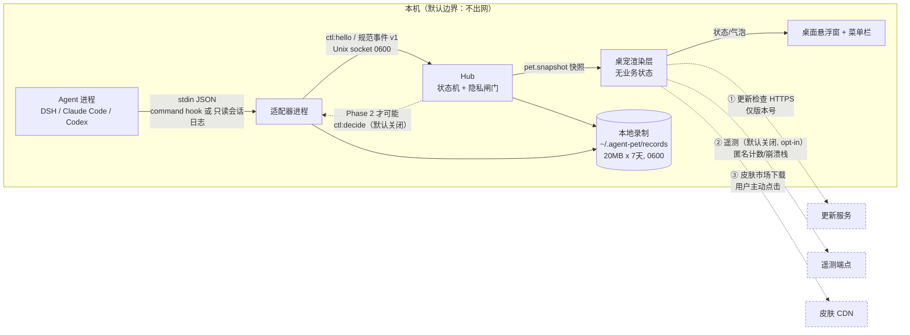

# 60 · 风险登记册、合规与竞品（Pre-mortem）

> 负责人：队友 B（product-experience）｜状态：**DRAFT v0.2**（2026-10-05，对齐契约 **v1.1**）｜复审节奏：每两周 Sprint 复审一次，触发器见 §7；v1.1 变更对本册的影响见 §9。
> 关联：[docs/00-interface-contract.md](./00-interface-contract.md)（契约 **v1.1**）、[docs/10-architecture.md](./10-architecture.md)（架构 DRAFT v0.9）、[docs/30-implementation-stack.md](./30-implementation-stack.md)（技术栈，**仍为占位**）、[docs/40-adapters.md](./40-adapters.md)（适配器矩阵 DRAFT v1）、[docs/50-product-spec.md](./50-product-spec.md)（产品规格 DRAFT v0.2）、[docs/20-roadmap.md](./20-roadmap.md)（路线图，**仍为占位**）、[docs/99-verification-report.md](./99-verification-report.md)（独立验收）。
> 证据分级：**[实测]**=本机命令/GitHub·Steam 官方 API 返回；**[原文]**=官方文档/法条原文引用；**[未验证]**=未取得可核验证据（已给出验证方法）。

---

## 1. 评分口径

- **概率 P（1–5）**：1 = 12 个月内几乎不会发生；2 = 不太可能；3 = 有可能（约 30–50%）；4 = 很可能（约 50–75%）；5 = 几乎必然。
- **影响 I（1–5）**：1 = 轻微（用户无感）；2 = 小（局部功能降级）；3 = 中（核心场景不可用/口碑受损）；4 = 大（产品无法上线/大量用户流失）；5 = 致命（项目终止、法律或重大安全事故）。
- **敞口 = P × I**。分级：**≥15 = 高**（必须有当期缓解动作与负责人）、**8–14 = 中**（有书面缓解方案，按 Sprint 排期）、**≤7 = 低**（记录 + 观察）。
- **负责人角色**（本项目 1–3 人，故用角色而非人名）：`Lead`、`客户端`、`适配器`、`体验`、`设计`、`QA`、`外部合规顾问`。

> 注意：本表**不写「已解决」**。每条都必须有可观测的触发信号（early warning），否则不算有效风险条目。

---

## 2. 风险登记册（21 条）

| ID | 风险 | 类别 | P | I | 敞口 | 缓解措施 | 触发信号（early warning） | 负责人角色 |
|---|---|---|---|---|---|---|---|---|
| **R-01** | 依赖第三方 agent 的**私有/未稳定接口**（hooks、内部事件、session 日志格式）导致适配器失效 | 依赖 | 5 | 4 | **20 高** | ①只依赖**文档化**的 hooks 面，不依赖内部 IPC；②契约层与适配层分离（契约 v1 冻结，适配器可单独发版）；③黄金 fixture 回归（`fixtures/*.pet.jsonl` + 回放脚本，见 T3/T6）；④适配器内置 `doctor` 自检 + 版本探测；⑤未知事件忽略并计数（契约 §1.5） | 某个后端的 `unknownEvents` 占比 >20%；适配器 `doctor` 报版本不匹配；用户报「状态不动」的 issue ≥3/周 | 适配器 |
| **R-02** | 上游 **hook 机制变更**（新增/改名事件、字段语义变化、执行模型变化） | 依赖 | 4 | 4 | **16 高** | ①适配器对 hooks 输入做**宽容解析**（缺字段→降级，不抛异常）；②订阅上游 release notes / changelog（DSH 桌面版、Claude Code、Codex）；③适配器版本矩阵门禁：新版本先在 CI 跑 fixture 回归再放行 | 上游发布含「hooks」关键词的 changelog；用户升级 agent 后事件数骤降 | 适配器 |
| **R-03** | **DSH 自身仍在 0.2.0-rc 阶段**（Phase 1 唯一后端），未 GA、可能破坏性变更 | 依赖 | 4 | 4 | **16 高** | ①不把 DSH 私有模块当 ABI：只走 command hook + 契约 socket；②锁定已验证的 DSH 版本（本机 0.2.0-rc.2，`hostProtocolVersion 4`）并在 README 声明兼容矩阵；③桌面端升级后自动跑一次「事件通路自检」，失败则提示而非静默 | DSH 发新版/升级提示；`desktop-runtime.json` 的 `hostProtocolVersion` 变化；hook 配置格式变化 | Lead + 适配器 |
| **R-04** | **macOS 公证（notarization）与签名**失败/被 Gatekeeper 拦截，用户装不上 | 技术/发布 | 3 | 4 | **12 中** | ①Developer ID 签名 + Hardened Runtime + 公证（Apple 官方流程：`developer.apple.com/documentation/security/notarizing-macos-software-before-distribution`，[实测] 本机抓取 200）；②CI 中做 `codesign --verify` + `spctl -a -vv` 门禁；③Homebrew Cask / 直链 DMG 双通道；④保留「未公证但可右键打开」的说明文档 | CI 公证步骤失败；`spctl` 返回 rejected；用户报「已损坏，无法打开」 | Lead |
| **R-05** | 读取用户会话日志引发的**隐私风险与 TCC/完全磁盘访问（FDA）边界** | 合规 | 4 | 5 | **20 高** | ①**默认不读任何 agent 的会话日志**：优先走 hooks；②确需日志兜底时，只读**用户显式授权**的单个目录，绝不全盘扫描；③不申请 FDA 就能覆盖的场景一律不申请（最小权限）；④在首次启动与设置页显示「我读了哪些文件」的实时清单 | 适配器代码里出现跨 App 容器路径；用户投诉权限弹窗；macOS 更新后权限被重置导致功能静默失效 | 适配器 + 外部合规顾问 |
| **R-06** | 本地 socket / 录制文件**权限过宽**，被同机其他用户或恶意 App 读取（事件含 workspace 路径与会话摘要） | 合规/技术 | 3 | 4 | **12 中** | ①目录 `~/.agent-pet` 与 `$TMPDIR/agent-pet` 权限 `0700`，socket `0600`，录制文件 `0600`；②不监听 TCP（WebSocket 备用通道默认关闭且仅 127.0.0.1，契约 §5）；③录制内容只含事件元数据与截断摘要，**永不含对话正文**；④轮转 20 MB × 7 天（契约 §5）限制泄露面 | 安全审计发现 >0700 权限；日志中出现正文片段 | 客户端 + 适配器 |
| **R-07** | **多 agent 并行运行**时 CPU/内存/GPU/磁盘占用叠加（agent 本身 + 桌宠） | 技术 | 3 | 3 | **9 中** | ①桌宠空闲目标 ≤150 MB 内存（与 T1 指标一致，**待回填**）、空闲 CPU ≤1%；②静态帧暂停渲染；③多后端徽标聚合而非多开窗口；④面板提供「当前占用」展示，超阈值自动降帧 | 内存 >200 MB 或空闲 CPU >3%；风扇持续转；用户报「卡」 | 客户端 |
| **R-08** | 桌宠**干扰工作流**（遮挡、抢焦点、声音惊吓、误触审批）→ 被卸载或被骂「又一个弹窗」 | 产品 | 4 | 4 | **16 高** | ①默认保守：点击穿透默认关但**一键可开**、声音可关、无自动弹窗骚扰；②审批卡片**不自动关闭**但也不无限骚扰（最多 3 次递增提醒，见 [docs/50](./50-product-spec.md) §2.6）；③全屏应用自动半隐藏 + 静音；④勿扰三档 + 「安静 1 小时」；⑤任何写回操作（Phase 2）默认关闭且需二次确认 | 卸载率上升；「太吵/挡住我」类反馈；用户长期开启勿扰 >50% | 体验 + 设计 |
| **R-09** | **单人开发者单点**（bus factor = 1）：生病/倦怠/兴趣转移即停摆 | 团队 | 4 | 4 | **16 高** | ①一切可核验资产进仓库（契约、fixture、决策记录、发布脚本）；②文档优先于代码（本仓库的 docs/ 即是）；③关键流程可被外部复现（`pnpm build` + fixture 回放 5 分钟出 demo）；④不承诺无法维护的 SLA；⑤提前定义**停止条件与交接包** | 连续 2 个 Sprint 无交付；issue 响应 >14 天；作者公开表达倦怠 | Lead |
| **R-10** | **皮肤/角色市场内容审核**失败（侵权素材、色情/政治内容、AI 生成未标注、恶意包） | 合规/商业 | 3 | 4 | **12 中** | ①皮肤包只允许**声明式 JSON + 图片/音频**，禁止可执行代码；②上架需版权声明 + 原创承诺 + 签名校验和；③分级默认全年龄，举报下架流程 48 小时内响应；④平台侧保留「无需理由下架」条款；⑤对 IP 联名皮肤走正式授权 | 收到 DMCA/侵权投诉；出现带脚本的皮肤包；社区举报激增 | Lead + 外部合规顾问 |
| **R-11** | **模型/API 成本**失控（若引入 LLM 生成气泡文案、语音或「AI 陪伴」功能） | 商业/技术 | 3 | 3 | **9 中** | ①MVP 文案**全部本地规则生成**，不做 LLM 调用；②如引入 LLM：默认关闭、用户自带 API Key（BYOK）、本地缓存 + 频次上限；③成本上限告警（月度预算硬闸） | 出现按 token 计费的调用；单用户月成本 >¥2；账单异常 | Lead |
| **R-12** | 契约演进失控：多适配器各自为政，契约成为「文档」而非「接口」 | 技术/流程 | 3 | 4 | **12 中** | ①契约变更走「修改契约 → 更新适配器矩阵 → 回归测试」三步（契约 §0 已定）；②契约一致性单测作为 CI 门禁（T6 的 `replay-check.mjs` 长期保留）；③版本号语义：破坏性才 +1 | 任一适配器跳过一致性测试；出现「这个后端特例」补丁 ≥2 处 | Lead + 适配器 |
| **R-13** | **竞品快速迭代且免费开源**（clawd-on-desk ⭐6,364、BongoCat ⭐23,790、OpenPets、UniPet…） | 商业 | 5 | 3 | **15 高** | ①差异化锚点：**跨后端广度 + 契约化适配器 SDK + 隐私默认最强 + 桌宠与 DSH 的深度集成**（见 [docs/50](./50-product-spec.md) §7）；②不与头部项目比功能数量，比「一次适配、多后端复用」的结构性效率；③开源适配器建立生态位 | 竞品新增我们规划中的特性；我们的 issue 里出现「为什么不用 X」 | Lead |
| **R-14** | **商业化失败**：品类普遍免费（实测多为 MIT/Apache 开源）导致付费转化极低 | 商业 | 4 | 4 | **16 高** | ①收入重心放在**皮肤/角色**（对标 Steam 实测 $11.99/角色 DLC）与企业版，而非功能订阅；②MVP 上线 4 周内做「假设价格页」验证点击意愿；③控制固定成本（无服务器、无云依赖）；④提前用文档记录停止条件 | 假设价格页点击率 <2%；皮肤预售 <50 单；企业询单为 0 | Lead |
| **R-15** | 权限被拒（辅助功能/通知）导致关键交互降级，用户以为「产品坏了」 | 产品/技术 | 3 | 3 | **9 中** | ①**无辅助功能权限也能用核心功能**（状态/气泡/审批提示不依赖全局快捷键）；②权限仅在使用对应功能时申请，并解释用途；③权限缺失时 UI 明确提示并可一键跳转系统设置 | 权限拒绝率 >40%；用户反馈「快捷键没反应」 | 体验 |
| **R-16** | 安装适配器时**改写用户的 agent 配置**（hooks）出错，损坏用户环境 | 技术/信任 | 3 | 4 | **12 中** | ①安装前展示 diff 并需确认；②写前备份（`*.bak-<ts>`），提供一键回滚；③幂等安装/卸载（可重复执行）；④失败即恢复原文件，绝不「半写」 | 用户报「Claude Code 启动报错」；配置文件 JSON 解析失败；出现重复 hook 条目 | 适配器 |
| **R-17** | 事件重复/乱序/丢失导致**状态显示错误**（例如永远显示「工作中」） | 技术 | 4 | 3 | **12 中** | ①按契约 §2 做 2 s/32 条乱序窗口 + `seq` 去重；②45 s 心跳缺失判离线、10 min 强制回 idle（契约 §4）；③`unknownEvents`/`stale` 计数可见；④T6 独立回放脚本作为门禁 | `stale` 计数增长；用户截图显示状态与实际不符 | QA + 客户端 |
| **R-18** | 点击穿透开启后用户**找不到桌宠/无法恢复**（可用性陷阱） | 体验 | 3 | 3 | **9 中** | ①穿透状态在菜单栏图标上有明确角标；②全局快捷键 `⌥⌘P` 可恢复，且 3 秒内连按两次回到「可点击」；③托盘菜单永远可恢复；④引导页不默认开启穿透 | 用户问「桌宠不见了」；穿透开启后 24 h 内未关闭的比例异常 | 体验 |
| **R-19** | **供应链风险**：npm/打包依赖被投毒、CI 凭证泄露、Electron/Tauri 上游漏洞 | 技术/安全 | 3 | 4 | **12 中** | ①锁定依赖版本 + lockfile 提交 + `pnpm audit` 进 CI；②发布走 CI 签名产物，本地不上传证书；③最小依赖（渲染用自有资产，不引入大型动画引擎）；④GitHub Actions 权限最小化 | `pnpm audit` 出现 high/critical；依赖包维护者变更；出现可疑安装脚本 | Lead + 客户端 |
| **R-20** | **IP/商标与角色形象**风险：角色形象被指抄袭、命名与 DSH/他方商标冲突、IP 联名皮肤越权 | 合规 | 2 | 4 | **8 中** | ①角色形象保留完整创作过程与源文件，必要时做外观检索；②名称「小深」等候选需做商标初筛（中国/美国，[未验证]）；③联名皮肤一律书面授权；④不复制任何现有产品的角色美术风格 | 收到侵权函；应用商店/市场以 IP 理由下架 | Lead + 外部合规顾问 |
| **R-21**（v1.1 新增） | **只读承诺与用户预期错位**：契约 v1.1 明确 Phase 1 只读（`canDecide:false`，卡片无允许/拒绝按钮），用户看到「等待审批」却点不了，误判为「产品坏了/没用」 | 产品 | 4 | 3 | **12 中** | ①卡片文案显式写「后端正在等待你的决定」并给「跳到窗口」主按钮（[docs/50](./50-product-spec.md) §2.6）；②`⌥⌘J` 一键跳到后端窗口/终端；③首次启动引导明确说明「本版本只读，不代替你做决定」；④面板「待办」页集中展示所有未决项 | 「为什么点不了」类反馈；审批卡片点击率低但跳转率也低；卸载理由含「没用」 | 体验 |

**敞口分布**：高（≥15）**8 条**：R-01、R-02、R-03、R-05、R-08、R-09、R-13、R-14（其中 R-01/R-05 为 20 分）；中（8–14）**13 条**（含 v1.1 新增的 R-21）；低 0 条；共 21 条。
> 结论：**高敞口集中在「依赖上游」「隐私合规」「单人团队」「商业化」四类**，与 §6 Pre-mortem 的三条失败路径一致。

---

## 3. Top 5 风险详述与当期动作

### R-01 适配器依赖私有接口（敞口 20）
- **现实依据**：[实测] DSH 0.2.0-rc.2 的钩子桥接明确「**只有 command 钩子会运行；`http`、`mcp_tool`、`prompt`、`agent` handler 会被跳过并给出警告**」（`app.asar!/dsh/node_modules/@deepseek-ai/dsh-hook-protocol/README.zh.md`）。即：我们的适配器**必须**是命令行可执行程序，任何「用 http hook 直连」的设计都会在 DSH 上静默失效。
- **当期动作**：把「适配器 = CLI（stdin JSON → socket）」写进契约实现与 [docs/40](./40-adapters.md)；在适配器加 `--self-test`，用 fixture 验证「原生事件 → 规范事件」的字段覆盖。

### R-05 隐私与 TCC/FDA 边界（敞口 20）
- **法律/系统事实**：macOS 的 TCC（Transparency, Consent, and Control）要求 App 访问受保护资源需用户授权；企业可通过 MDM 的 `PrivacyPreferencesPolicyControl` payload 预授权（Apple 文档，[实测] 200：`developer.apple.com/documentation/devicemanagement/privacypreferencespolicycontrol`）。
- **我们的设计决策**：**不申请完全磁盘访问（FDA）**，因此**不做**「读取任意 agent 会话日志」的功能；事件来源限定为 hooks 与用户显式指定的文件。若某后端（例如只能通过 transcript 拿事件的场景）必须读日志，则该后端标记为「需要用户手动授权目录」并提供降级体验（只显示在跑/结束）。**具体哪些路径会被 TCC 拦截，[未验证]**（验证方法：写一个最小 App 尝试 `open()` `~/.claude/projects/*.jsonl` 与 `~/Library/Application Support/...`，观察是否触发授权弹窗）。
- **对产品的硬约束**：契约 §1.4/§3.3 的「不传正文」是合规底线，不是优化项。

### R-03 DSH 0.2.0-rc 稳定性（敞口 16）
- [实测] `desktop-runtime.json`：`version 0.2.0-rc.2`、`hostProtocolVersion 4`。rc 阶段意味着 hook 形态与事件名可能变。
- **动作**：①兼容矩阵文档化（DSH 版本 → 适配器版本 → 契约版本）；②在适配器启动时读 `/Applications/DeepSeek Harness.app/Contents/Info.plist` 的版本号做**能力探测**（不写入、不修改）；③DSH 升级后首次运行时自动跑一次 fixture 回归并在失败时提示用户。

### R-08 干扰工作流（敞口 16）
- 参照物：[实测] `clawd-conduit` 明确「**卡片永不自动关闭**（`permissionBubbleAutoCloseSeconds: 0`）。自动关闭是最糟的默认值：你以为你拒绝了，其实它只是超时并退回终端提示」——这条经验同时是「不自动关闭」与「防骚扰」的矛盾点。
- **动作**：声/抖/置顶三项**分别可关**；提醒次数上限 3 次且间隔递增；全屏自动半隐藏；提供「安静 1 小时」。

### R-09 / R-13 / R-14（团队 + 竞争 + 商业化，合计构成「死亡三角」）
- 单人 + 免费开源竞品 + 付费意愿低 ⇒ 任何一条失控都会放大另两条。**动作**：见 §6 路径 2 的预防。

---

## 4. 合规与隐私

### 4.1 数据流图（哪些数据离开本机）

**说明**：①②③ 是**唯一**的三条出网路径，全部可关闭/为用户主动行为；**没有任何路径上传对话正文、文件内容、命令输出或工作目录全路径**。

### 4.2 数据分类与最小化

| 数据 | 位置 | 是否出网 | 最小化措施 |
|---|---|---|---|
| 规范事件（元数据：type/ts/seq/sessionId/workspace/toolName/summary） | 本机 socket + 录制文件 | 否 | 契约 §2 ≤8 KB/事件；`summary` 截断；`workspace` 可配置为「只保留末段」 |
| 助手消息摘要（≤280 字符） | 本机（仅内存 + 可选录制） | 否 | 契约 §3.2 已截断/脱敏；渲染层再截到 60 全角字；提供「不显示气泡」开关 |
| 工具名与命令摘要 | 本机 | 否 | 正则过滤疑似密钥/令牌（`sk-`、`ghp_`、`AKIA`、长 base64）；路径只显示 basename |
| 会话 ID / 工作目录 | 本机 | 否 | 面板中默认脱敏显示（`~/work/…/proj`） |
| 状态迁移日志（最近 500 条） | 本机内存/文件 | 否 | 只存事件类型，不存内容 |
| 崩溃栈（仅在开启遥测时） | 遥测端点 | 是（opt-in） | 去除路径与用户名；发送前可预览 |
| 皮肤包 | 本地 | 用户主动下载时才出网 | 只允许声明式 JSON + 图片/音频 |

### 4.3 权限声明清单（申请即成本）

| 权限 | 是否申请 | 用途 | 不申请的后果 |
|---|---|---|---|
| 通知（Notification） | 可选申请 | 后台/勿扰时的审批提醒 | 降级为菜单栏角标 |
| 辅助功能（Accessibility） | **可选**（仅全局快捷键与穿透切换） | 全局热键 | 降级为「桌宠聚焦时快捷键有效」 |
| 登录项（Login Item / `SMAppService`） | 用户显式开启 | 开机自启 | 需手动启动 |
| 屏幕录制 | **不申请** | — | 不做「看屏」类功能 |
| 完全磁盘访问（FDA） | **不申请** | — | 不做「读任意 agent 日志」类功能（见 R-05） |
| 网络 | 仅更新检查/遥测（可关）/皮肤下载 | — | 离线可用 |

### 4.4 GDPR 与《个人信息保护法》要点

> 法条原文来源（均已 [实测] 本机抓取 200）：GDPR 全文 `https://eur-lex.europa.eu/eli/reg/2016/679/oj`；《中华人民共和国个人信息保护法》全文 `http://www.npc.gov.cn/npc/c2/c30834/202108/t20210820_313088.html`；配套 `https://www.cac.gov.cn/2021-08/20/c_1631050028355286.htm`。以下为**产品侧要点归纳**，具体法律意见需外部合规顾问确认（[未验证] 的部分已标注）。

| 议题 | 我们的立场 | 待办 |
|---|---|---|
| 处理者身份 | 默认**全部在本机处理**，不构成向第三方提供个人信息；仅当用户开启遥测/下载皮肤时才涉及网络传输 | 隐私政策中明确写清「默认本地处理」与三条出网路径 |
| 合法性基础（GDPR Art.6） | 本地处理不涉及；遥测走**同意**（opt-in，可随时撤回） | 遥测同意页需可撤销且撤回后立即可用 |
| 数据最小化（Art.5(1)(c) / PIPL 第 6 条最小必要） | 契约 §3「不做」清单即最小化的技术实现 | 每次新增事件类型都要过一遍「是否必要」评审 |
| 存储限制（Art.5(1)(e)） | 录制 20 MB × 7 天轮转；状态日志 500 条上限 | 提供「一键清除全部本地数据」 |
| 用户权利（访问/删除/可携 Art.15–20；PIPL 第 44–50 条） | 全部数据在本地：导出 = 复制录制文件；删除 = 设置页一键清除 | 导出格式用契约 JSONL（本身即开放格式） |
| 敏感个人信息（PIPL 第 28 条：单独同意） | **不采集**生物识别、行踪、医疗等敏感信息；不采集键盘输入内容 | 代码审查门禁：禁止新增键盘/剪贴板监听 |
| 跨境传输 | 遥测若使用境外服务 → GDPR 需 SCC/DPF；PIPL 需标准合同或安全评估 | **[未验证]**：遥测端点选型未定；MVP 建议**不开遥测**以规避该议题 |
| 未成年人 | 不针对未成年人设计，不采集年龄 | 隐私政策声明 |
| Apple 隐私清单 | macOS 分发需注意 Apple 对特定 API 的 reason 声明要求 | **[未验证]**：需确认 macOS 侧当前是否强制 `PrivacyInfo.xcprivacy`，验证方法：查 Apple 最新分发要求文档并在 TestFlight/公证流程中实测 |

### 4.5 遥测默认关闭（产品承诺）

1. 安装时不默认开启；首次询问明确写「发送什么」并给出 payload 预览。
2. 关闭状态**零网络请求**（可用 Little Snitch / `tcpdump` 验证，写进验收清单）。
3. 开启后只发送：匿名安装 ID（可重置）、状态迁移计数、崩溃栈（去路径）；**不发送**事件内容、workspace、会话 ID。
4. 设置页随时可导出「我发送过的所有数据」。

---

## 5. 竞品与先例（≥6，全部 2026-10-05 实测）

> 元数据来源：`https://api.github.com/repos/<owner>/<repo>`（星标/许可证/最后推送时间）与官方 README（经 jsDelivr 镜像抓取）；Steam 数据来自 `https://store.steampowered.com/api/appdetails`。访问日期均为 **2026-10-05（Asia/Shanghai）**。

| # | 产品 | 完整 URL | 实测事实 | 与我们的差异 | 可借鉴点 / 威胁 |
|---|---|---|---|---|---|
| 1 | **Clawd on Desk** | `https://github.com/rullerzhou-afk/clawd-on-desk` | ⭐6,364，AGPL-3.0，JS，最后推送 2026-10-05（当天仍在活跃） | 单桌宠多 agent，功能最全；AGPL 限制闭源商业复用 | **最大直接竞品**。借鉴其「内置主题 + 自定义主题 + 导入 Codex Pet 动画包」的皮肤体系；威胁：它先发且免费 |
| 2 | **clawd-conduit** | `https://github.com/ssssssanjiu/clawd-conduit` | ⭐180，MIT，Shell；README 明确「all 15 hook events」「权限卡片永不自动关闭」「`Cmd+Shift+Y/N` 就地批准」 | 只做接线层（依赖 Clawd），不做跨后端抽象 | **UX 经验直接可用**：审批卡片不自动消失、桌面就地批准、Dock 闪烁 + 声音完成提醒 |
| 3 | **BongoCat** | `https://github.com/ayangweb/BongoCat` | ⭐23,790，Apache-2.0，Rust（Tauri），README：Live2D + 完全开源 + 离线 + 不收集数据 | 交互陪伴型，与 agent 无关 | **技术先例**：Tauri + Live2D 跨平台（macOS/Windows）已被 2.3 万星验证；「模型可换 + 隐私叙事」的社区传播力 |
| 4 | **OpenPets（平台版）** | `https://github.com/OpenPetsHQ/openpets` | ⭐1,261，MIT，TS；自述「Local first, desktop companion platform with animated pets, plugin SDK and coding-agent integrations」，提供 MCP server | 与我们的 Phase 2 定位最接近 | **威胁最大**：它已有 plugin SDK + MCP 接入面；借鉴其 MCP 作为统一控制通道的做法 |
| 5 | **OpenPets（macOS 原生版）** | `https://github.com/alterhq/openpets` | ⭐98，MIT，Swift；菜单栏 App + CLI + MCP 三入口共享同一只宠物；要求 macOS 14+ | 原生 Swift，仅 macOS | 借鉴 `OpenPetsKit` 可嵌入 SDK 的分层；三入口共享状态的架构 |
| 6 | **UniPet** | `https://github.com/ydyangdan/UniPet` | ⭐38，MIT，JS；自述「connectors send facts, while UniPet owns behavior, bubbles, and rendering」；localhost HTTP/WebSocket 协议；npm `uni-pet` 近 30 天下载 **40**（`api.npmjs.org/downloads/point/last-month/uni-pet`） | 架构与我们契约同构（事实/表现分离） | **验证了契约 §1.1 的方向**；同时说明该品类当前真实用户规模很小（下载量两位数） |
| 7 | **AgentPet** | `https://github.com/ntd4996/agentpet` | ⭐376，MIT，Swift；菜单栏监控每个 agent 状态 + 桌宠；「被真实工作量喂养」的成长系统 | 单机 macOS，含游戏化留存 | 借鉴「菜单栏总览 + 桌宠情感化」双通道；XP/成就的留存设计 |
| 8 | **Desktop Mate** | `https://store.steampowered.com/app/3301060/` | Steam API 实测：`is_free=true`，24 个 DLC；4 个角色 DLC 实测 **$11.99**（原价 $14.99） | 纯陪伴 3D 桌宠（VRM + IP 联动），非 agent | **商业化范式**：本体免费 + 角色 DLC；证明「为角色付费」成立 |
| 9 | **Mate-Engine** | `https://github.com/shinyflvre/Mate-Engine` | ⭐3,738，最后推送 2026-01-20；自述为 Desktop Mate 的免费替代 + 自定义 VRM | 3D 桌宠替代品 | 证明「自定义 VRM」是社区强需求 |
| 10 | **Claude Code Usage Monitor** | `https://github.com/Maciek-roboblog/Claude-Code-Usage-Monitor` | ⭐8,732，MIT，Python，最后推送 2026-07-05；自述「Real-time Claude Code usage monitor with predictions and warnings」 | 纯数据面板，无角色 | **相邻品类**：开发者确实会为「看见 agent 状态/成本」装东西；可借鉴其成本预测展示 |
| 11 | **Vibe Kanban** | `https://github.com/BloopAI/vibe-kanban` | ⭐28,264，Apache-2.0，Rust，最后推送 2026-09-19 | 看板式多 agent 编排 | 「多 agent 并行需要一个统一视图」的需求规模已被 2.8 万星验证 |
| 12 | **cc-haha** | `https://github.com/NanmiCoder/cc-haha` | ⭐14,863，MIT，TS；本地优先的 agent 桌面工作台（多 agent、worktree、skill 市场） | 工作台而非桌宠，争夺同一注意力预算 | 借鉴其「本地优先 + skill 市场」的生态打法 |

**结论**：①该品类**不空白且竞争激烈但普遍免费**；②我们的结构性差异只有「契约化的多后端适配层 + 隐私默认最强 + 桌面体验细节」；③商业化必须靠皮肤/角色与企业，**[见 [docs/50](./50-product-spec.md) §6.2]**。

---

## 6. Pre-mortem：项目失败的三条最可能路径

> 写法：假设 12 个月后项目已失败，倒推最可能的三条因果链，并给出**当期**预防动作（不是「注意一下」）。

### 路径 1：上游一改，桌宠就「装死」——适配器脆弱性死亡螺旋
**链条**：某次 agent 升级改了 hook 字段 → 适配器静默失配 → 桌宠长期停在 idle 或错误状态 → 用户以为「这玩意没用/骗人」→ 卸载 + 差评 → 开发者为救火疲于奔命 → 停止维护。
**为什么最可能**：R-01/R-02/R-03 都是高敞口，且我们**没有任何上游的控制权**。
**预防动作（当期）**：
1. 适配器「宽容解析 + 未知事件忽略并计数」（契约 §1.5），**绝不抛异常**。
2. 黄金 fixture 回归进 CI（T3 的 `fixtures/*.pet.jsonl` + T6 的独立回放脚本）；任何适配器改动都必须通过。
3. 适配器内置 `--self-test` 与 `doctor`：一条命令回答「现在能不能收到事件、收不到是哪一环断了」。
4. 上游 changelog 订阅 + 兼容矩阵（DSH 版本 × 适配器版本 × 契约版本）写在 README 顶部。
5. 版本探测：适配器启动时读 agent 版本号，遇到未知版本发一条「降级运行」提示给用户（不静默）。

### 路径 2：没人付钱——免费开源竞品 + 低付费意愿 + 单人现金流
**链条**：MVP 上线 → 用户量小（实测同类 npm 月下载两位数）→ 免费竞品功能更多 → Pro 转化 <1% → 6 个月后开发者收入为 0 → 精力转向别处 → 项目停更。
**预防动作（当期）**：
1. **不做「功能订阅」**，做「皮肤/角色 + 企业」：Steam 实测角色 DLC $11.99 是已被验证的付费点（Desktop Mate 24 个 DLC）。
2. 上线 4 周内做「假设价格页」A/B（不接支付），用真实点击率决定是否继续投入；若点击率 <2% → 触发**停止条件**评估。
3. 成本近乎为零：无服务器、无云依赖、BYOK；即使 0 收入也能长期挂着（避免「必须马上赚钱」的死线）。
4. 提前写「交接包」：契约 + fixture + 构建脚本 + 发布流程，使项目可被他人接手。
5. 明确「停止条件」并公开（例如：12 个月后月活 <500 且企业询单 = 0 → 转为纯开源维护模式）。

### 路径 3：体验翻车——「又一个抢焦点、乱弹窗的骚扰软件」
**链条**：默认开启声音与置顶 → 在会议/全屏/游戏时突然抖动 + 响铃 → 用户社死 → 立刻卸载并在社交媒体吐槽 → 口碑定型（「别装那个，很吵」）→ 再也拉不回来。
**预防动作（当期）**：
1. **默认值保守**：声音默认开但**首次审批提醒前先播放一次试听并说明如何关闭**；全屏自动静音 + 半隐藏（[docs/50](./50-product-spec.md) §2.10）。
2. 「打扰预算」可观测：设置页显示「本周提醒 37 次，其中 12 次被忽略」；审批提醒最多 3 次且间隔递增。
3. 一键「安静 1 小时」放在右键菜单第一屏；勿扰三档 + 豁免策略（审批永不被完全吞掉，见 [docs/50](./50-product-spec.md) §1.5）。
4. 「不可撤销操作」的写回一律默认关闭（Phase 2 Gate，见 [docs/50](./50-product-spec.md) §5.3），避免误触造成真实损失。
5. 内测阶段用 opt-in 遥测观察**关闭提醒的比例**与**禁用率**，作为「骚扰度」指标（阈值：禁用率 >10% 即回滚默认值）。

---

## 7. 监测与复审

| 频率 | 动作 | 输出 |
|---|---|---|
| 每两周 Sprint 复审 | 逐条更新 P/I，检查触发信号；高敞口条目必须有当期动作 | 本文件 diff（版本号 v0.x 递增） |
| 每月 | 检查 §2 触发信号看板：`unknownEvents` 占比、`stale` 计数、权限拒绝率、卸载反馈关键词 | 是否新增风险条目/升级敞口 |
| 每次上游版本发布 | 兼容性回归（fixture + doctor） | 兼容矩阵更新 |
| 每个里程碑 | 重跑 Pre-mortem（§6）：三条路径是否变化 | 路线图调整（[docs/20](./20-roadmap.md)，**待完成**） |

---

## 8. 未验证项与验证方法

| 项 | 为什么重要 | 验证方法 |
|---|---|---|
| macOS Focus/专注模式状态是否可被第三方读取 | 自动勿扰 | 在 macOS 26/27 上尝试 Focus Status API（需 entitlement）或在沙箱外试验 `NSWorkspace`；失败则只做手动开关 |
| 哪些路径会被 TCC 拦截（`~/.claude/projects` 等） | R-05 的边界 | 写最小 App 尝试 `open()` 这些路径，观察是否触发授权弹窗 / 返回 EPERM |
| Apple 对 macOS 侧隐私清单（`PrivacyInfo.xcprivacy`）的当前强制范围 | 公证与上架 | 查 Apple 最新分发要求 + 在公证流程中实测 |
| Apple Developer Program 年费与公证要求的最新价格 | R-04 成本 | 查 `developer.apple.com/programs/`（本机网络受限，未验证） |
| Live2D SDK Release License 的费用档位 | 商业化成本（年营收 >1000 万日元的触发线已在 LICENSE 原文确认） | 在干净网络访问 `live2d.com/en/download/cubism-sdk/release-license/`（本机 DNS 被劫持） |
| Spine 编辑器价格与「终端用户需自购许可」的例外条款 | 资产选型 | 访问 `esotericsoftware.com/spine-purchase` 与 Spine Editor License Agreement |
| 该品类真实用户规模 | R-13/R-14 | npm/下载量、GitHub star 增长、Steam 评论数（已有部分实测：`uni-pet` 月下载 40） |

---

## 9. v1.1 对齐说明（2026-10-05 补记）

契约已从 v0.1 升级到 **v1.1**（[`docs/00-interface-contract.md`](./00-interface-contract.md)，响应 [`docs/99-verification-report.md`](./99-verification-report.md) 的 P0）。对本册的影响：

| v1.1 变化 | 对风险登记册的影响 |
|---|---|
| §1.6 / §5.4 明确 **Phase 1 只读**（适配器 `canDecide:false`；审批卡片**无**允许/拒绝按钮） | ① **降低**误操作类风险（桌宠不可能代替用户批准不可撤销操作）；② **新增 R-21**（只读与用户预期错位）；③ Phase 2 写回 Gate 的二次确认 + 审计日志（§5.4）成为 R-10/R-16 的补充缓解 |
| §4.4 / §4.5 拆成「45 s 判连接 / 10 min 清会话」两条独立规则；心跳不刷新 `lastStateChangeTs` | R-17 的缓解更新为：清理必须**留痕**（否则用户漏审批）；并新增建议 C8（`pet.snapshot.clearedPending[]`）以支撑留痕 |
| §3.3 审批/提问强制 `requestId`/`questionId` 配对，禁止 FIFO 猜测 | R-17 概率下降：配对失败改为可计数的 `orphanApprovals`/`orphanAnswers`，不再错配到别的请求 |
| §5.2 握手 `ctl:hello`/`ctl:ack`（3 s 超时、重试 2 次、`resumeAfter` 续传、`ok:false` 必须退出） | R-01/R-02 缓解新增「能力协商 + 版本不匹配即拒收（`unsupported-contract`）」，避免静默半可用 |
| §3.4 `agent.status` 覆盖规则（10 s / 优先级 ≥ 当前 / `force`；被拒计 `overrideRejected`） | 消除「后端自报状态压掉 `waiting`」的漏提醒路径，R-08 的「漏提醒」侧风险下降 |
| §3 统一为「16 个 type 字符串 / 16 行」计数 | R-12 的验收口径明确：契约一致性测试按 **16 行**计数 |

**未因 v1.1 消除的风险（敞口不变）**：R-01/R-02/R-03（上游依赖）、R-04（公证签名）、R-05（隐私与 TCC）、R-09（单人单点）、R-13/R-14（竞争与商业化）。

### 附：本文档的实测来源（全部 2026-10-05，Asia/Shanghai）

- DSH 钩子协议（command-only、退出码 2 阻塞、Codex 不支持请求确认）：`app.asar!/dsh/node_modules/@deepseek-ai/dsh-hook-protocol/README.zh.md`（本机 asar 头部解析）。
- DSH 版本与 host 协议：`app.asar!/dsh/desktop-runtime.json` → `0.2.0-rc.2` / `hostProtocolVersion 4`。
- Apple：`https://developer.apple.com/documentation/security/notarizing-macos-software-before-distribution`（200）、`https://developer.apple.com/documentation/devicemanagement/privacypreferencespolicycontrol`（200）。
- GDPR 全文：`https://eur-lex.europa.eu/eli/reg/2016/679/oj`（200）。
- 《个人信息保护法》全文：`http://www.npc.gov.cn/npc/c2/c30834/202108/t20210820_313088.html`（200）；网信办配套页 `https://www.cac.gov.cn/2021-08/20/c_1631050028355286.htm`（200）。
- 竞品元数据：GitHub REST API `/repos/{owner}/{repo}` 与 `/search/repositories`；Steam `appdetails`；npm `api.npmjs.org/downloads/point/last-month/...`。
- 本机网络限制说明：`www.live2d.com`、`esotericsoftware.com`、`github.com` 直连不可用（DNS 被劫持/证书不匹配/连接重置），本文相关外部事实改用 jsDelivr 镜像与官方 API 取得；无法取得的一律标注 **[未验证]**。
